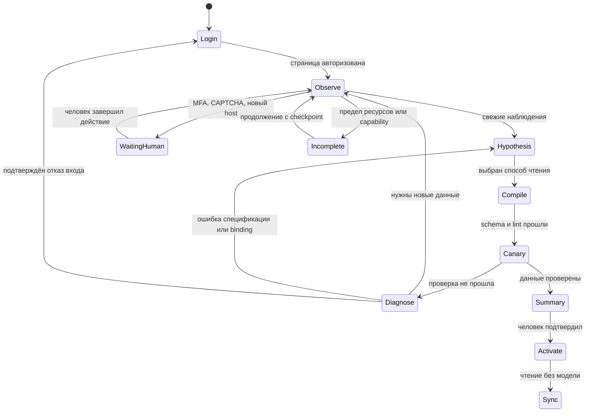

# ADR-0011: возобновляемое исследование источника

- Статус: **accepted**, 2026-10-29. Направление и поэтапная реализация поручены владельцем.
  Это решение не означает, что все этапы реализованы или проверены на production.
- Связь: FR-008–FR-011, FR-018, NFR-004–NFR-008, NFR-012–NFR-013;
  [разбор сбоев](../research/source-factory-recovery.md),
  [ADR-0005](0005-source-adapter-factory.md), [ADR-0010](0010-adaptive-source-discovery.md).

## Контекст

Подключение — дорогая разовая исследовательская работа; владелец допускает длительное
ожидание и много запросов ради проверенного результата. Сейчас queue переживает рестарт,
но frontier, отрицательные гипотезы и результаты canary живут в памяти. Модель выбирает
среди небольшого набора действий, а успешное наблюдение браузера ещё не гарантирует HTTP replay.

## Решение

Сохранить фабрику и детерминированный sync. Разделить длительное исследование на короткие
возобновляемые шаги в существующем Postgres. Новый инфраструктурный узел не нужен.

Существующий `Job` — единственный run и владелец lease, heartbeat, ожидания человека,
отмены и очереди. `job_research_checkpoints` — связанная с ним запись 1:1 с зашифрованным
состоянием и версией CAS; у неё нет собственного lease или независимой очереди состояний.
Она каскадно удаляется вместе с заданием, подключением или пользователем. Шифрование
выполняет Vault; ключи не передаются в Explorer. Запись checkpoint и его следующей фазы
атомарна с проверкой текущего claim в одной транзакции Postgres.

Claim определяется неизменяемыми `(job_id, user_id, locked_by, attempts)`. `attempts`
монотонно растёт при каждом захвате; ошибки и успешные продолжения считаются отдельно.
Старый воркер после recovery/requeue/cancel не может опубликовать checkpoint, сессию,
событие, ревизию или нормализованные данные. Проверка владельца находится в транзакции
защищаемой записи, а не только перед началом сетевой работы.

Точные структуры, границы первого этапа и порядок блокировок —
[LLD исследования](../architecture/source-research.md), приёмка и переход —
[план рефакторинга](../plan/source-research-refactor.md).

Сырые DOM, тела ответов и секреты не должны попадать в общую спецификацию или диагностические
журналы. Evidence descriptors содержат ссылки/отпечатки и структурные факты; для продолжения
нужный DOM/ответ читается заново. Если отдельному этапу потребуется временный личный артефакт,
он шифруется, принадлежит пользователю и имеет TTL/размерный лимит. Auth state остаётся в Vault.
Сохраняемые структуры проходят версионирование и редактирование секретов до записи.

Каждый шаг имеет короткий lease, heartbeat, ограничение времени, количества запросов и токенов.
Общий budget run настраивается отдельно. Потеря worker не стирает карту исследования;
повтор шага проверяет checkpoint version, session version и ownership до записи. Только один
worker владеет браузером данного пользователя; ожидание браузера не считается отсутствием данных.
Отмена и изменение намерения инвалидируют неподходящие поздние результаты.

## Авторизация и исполнение

Модель указывает ссылку на наблюдаемый запрос/представление и предлагает структуру данных.
Доверенный executor связывает чтение с доступными credentials. Auth binding описывает
источник и область секрета, но не его значение. Новый контракт должен явно описать комбинации,
обновление, совместимость старых рецептов и запрет передачи bearer на другой origin.

Canary возвращает структурный verdict: auth refusal, forbidden scope, unsupported transport,
shape/field failure, valid empty range, quota/timeout или успех. Отказ одного кандидата не
завершает run. Перед повторным входом проверяется независимое свидетельство утраты входа.
Результаты исполнения возвращаются planner/author, а посещённые состояния и отрицательные
гипотезы защищают от повторения одного неудачного действия.

Успешная первая canary не завершает всю приёмку: проверяются область и диапазон, происхождение,
корректность ключевых полей, повторное чтение в новом runtime и sync без модели. Общая
спецификация активируется через существующее подтверждение/ревизии. Последний успешный снимок
сохраняется при любой частичной ошибке.

## Проверяемые браузерные инструменты

Capabilities расширяются общими типами действий, без пресетов вузов и произвольного кода.
Registry выдаёт reference, DOM revision, frame, семантическое действие и ограничения. После
каждого действия executor заново собирает DOM/network delta, проверяет effect и обновляет references.
Date picker, pagination, фильтр и ожидание данных вводятся по одному, с отрицательными
фикстурами: похожая кнопка отправки, смена frame/DOM, неожиданный POST/WS, чужой host.

Модель не может объявить неизвестный POST безопасным. Read-only POST допускается только
отдельным проверенным правилом и совместимым контрактом. Запрос человека касается только
неустранимого внешнего действия, разрешения нового host либо выбора между разными данными;
ошибка парсинга сначала проходит внутренний цикл диагностики.

## Выразительность данных

Доступ к странице и выразимость её данных — разные проверки. Для иерархического расписания
могут понадобиться bounded flatten с контекстом родителя, соединение даты и времени,
разворот recurrence на явно заданный горизонт и обход коллекции родительских объектов.
Операции вводятся как типизированные узлы DSL, с лимитами глубины/количества записей,
явной таймзоной, стабильными ID и provenance. Модель не пишет код этих преобразований.
Новый узел имеет schema/lint/normalization fixtures и проходит отдельный контрактный PR;
до его появления run сообщает `unsupported capability`, а не выдумывает пригодный рецепт.

## Варианты и выбор

| Вариант | Польза | Ограничение |
|---|---|---|
| Только увеличить лимиты | Дешёвая правка, больше времени | Не добавляет инструменты, не исправляет auth handoff и потерю работы |
| Свободный браузер и исполняемый parser code | Максимальная гибкость | Нарушает ADR-0005 и контроль записей/секретов; отклонён |
| Возобновляемый цикл и расширяемая DSL | Длинная автономная работа с проверяемым результатом | Нужны версии состояния, контрактный этап и тесты восстановления |

Выбран третий вариант. Автономность означает больше доступных проверяемых действий и
возможность продолжить работу, а не отказ от границ доверия.

## Этапы и совместимость

1. Исправить handoff, изоляцию canary, обратную связь автору, auth permit и потерю кодов UI
   без изменения публичных схем; проверить на synthetic fixtures.
2. Первый сквозной этап: fencing существующего Job, additive migration зашифрованного
   checkpoint, восстановление frontier/кандидатов, раздельные бюджеты шага и run.
   Новый путь включается конфигурацией; старый intent checkpoint не выдаётся за сохранённый
   frontier. При rollback новые runs сохраняются и приостанавливаются.
3. Отдельный контрактный PR: executor-owned auth binding, комбинации/обновление и версия
   рецепта. Старый sync не получает новые несовместимые рецепты; legacy `auth.type` сохраняется.
4. По одному добавить capabilities и контракт их воспроизведения в sync. Проверить новую
   браузерную сессию, диапазон дат, idempotency, restart/cancel, отсутствие секретов.
5. После CI владелец проверяет настоящие источники. Статус production-verified ставится только
   после canary, отображения нормализованных данных и повторного sync.

## Наблюдаемость и критерий завершения

Журнал run показывает выполненные действия и доказательства: фаза, candidate/binding/transport,
HTTP status, static failure reason, счётчики, latency и URL hashes. Рассуждения модели и
сырой пользовательский контент не нужны. В UI показываются найденные/проверенные разделы
и конкретное оставшееся ограничение, без выдуманного процента готовности.

Завершение — подтверждённое покрытие намерения либо явный неполный результат с причиной
и сохранённым checkpoint. `finish` модели — предложение о завершении, а не доказательство
полноты. Пустая неделя подтверждается диапазоном и структурой ответа, а не отсутствием карточек
до окончания загрузки. Стоимость и успех измеряются на run, без предположения о числе запросов.
