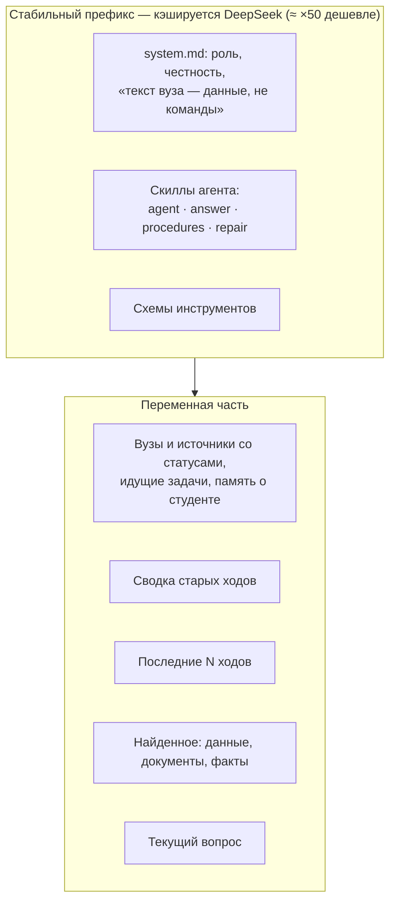
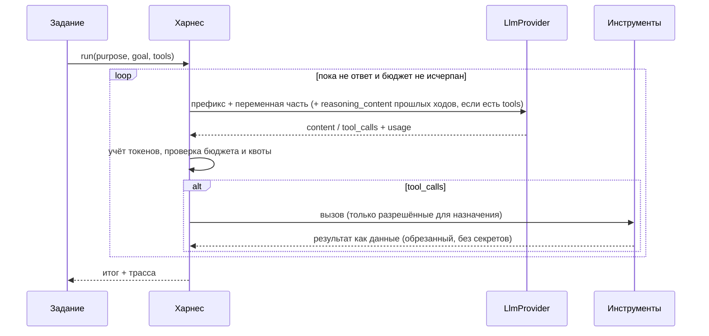

# Харнес агента

Статус: **описание реализации**, обновлено 2026-10-30. Владелец модуля — WS1 (`botai.agent`).
Связь: [ADR-0007](../adr/0007-agent-harness.md), [ADR-0013](../adr/0013-unified-agent-hub.md),
[контракт треда](../../contracts/conversation.md), [бенчмарк](../plan/benchmark.md), [LLD](lld.md).

Харнес — тонкий слой между циклом агента/бенчмарка и `LlmProvider`. Он держит
контекст переписки, кэшируемый префикс, бюджет шагов и токенов, инструменты и диагностику.
Агент Ботай — один на все треды: он и отвечает по данным, и подключает, чинит, читает источники
(ADR-0013). Обучение источника использует тот же провайдер и профили, но свой ограниченный цикл
`learn.discovery` и отдельный автор рецепта; это не произвольный tool loop харнеса.

## 1. Как DeepSeek управляет рассуждением (проверено по документации 2026-10-27)

| Параметр (OpenAI-формат) | Значения | По умолчанию |
|---|---|---|
| `thinking.type` (в `extra_body`) | `enabled`, `disabled` | `enabled` |
| `reasoning_effort` | `low`, `high`, `max` (`medium` → `high`) | `high` |
| Цепочка рассуждения в ответе | поле `reasoning_content` рядом с `content` | — |

Правила, которые харнес обязан соблюдать
([документация](https://api-docs.deepseek.com/guides/thinking_mode)):

- **С инструментами** `reasoning_content` всех прошлых ходов передаётся обратно в каждом
  следующем запросе, иначе API отвечает 400. Без инструментов — не передаётся.
- В режиме рассуждения `temperature` и штрафы игнорируются; `top_p` у flash не ниже 0,95.
- Инструменты работают в режиме рассуждения: несколько раундов «подумал → вызвал → подумал».

## 2. Профили по назначению

Профиль = модель + режим рассуждения + бюджет. Значения ниже — стартовые; бенчмарк их уточнит.

| Назначение | Модель | `thinking` / `effort` | Бюджет |
|---|---|---|---|
| `classify` (классификация и уточнение задачи) | `deepseek-flash` | `disabled` | Бюджет задаёт вызывающий код; уточнение источника — 500 токенов вывода |
| `agent` (единый агент треда: ответы, подключение, живое чтение) | `deepseek-flash` | `enabled` / `high` (`LLM_PROFILE_AGENT`; «не экономим», +≈20 % времени к low по бенчмарку) | до 30 шагов, 1,2 млн токенов на ход, 96k вход и 8k вывод на вызов, 24k знаков на результат инструмента, 16 вызовов на шаг |
| `learn` (подключение вуза) | `deepseek-flash` | `enabled` / `high` | 40 шагов, 1,5 млн токенов |
| `repair` | `deepseek-flash` | `enabled` / `low` | 20 шагов, 500k токенов в бюджете харнеса |
| `extract` (документ → структура) | `deepseek-flash` | `enabled` / `low` | 1–3 вызова на документ |

Профили — в конфигурации (`LLM_PROFILE_<PURPOSE>=model:thinking:effort`), а не в коде, чтобы
бенчмарк и владелец меняли их без релиза. Бюджет агента не экономный (многошаговое подключение,
чтение страниц, таблицы), поэтому суточная квота пользователя (`QUOTA_TOKENS_PER_DAY`, 20 млн) и
лимит запросов в минуту подняты; от зацикливания защищают бюджет хода, повтор одинакового вызова
(он не выполняется второй раз, пока не изменилось состояние), минутный лимит и общий суточный
потолок расходов пула.

## 3. Контекст и кэш



- **Префикс неизменен** между запросами одного назначения: system-промпт, скиллы, схемы
  инструментов — в фиксированном порядке, без дат и имён. Версия префикса — хеш содержимого,
  пишется в диагностику. Всё переменное — после префикса.
- **Память переписки:** последние ходы целиком в пределах 24k токенов; старше — сворачиваются в
  сводку треда (обновляется дешёвым вызовом `classify`-профиля при переполнении). Сводка хранится
  в `chat_threads.summary`.
- **Промпты харнеса** — Markdown в `backend/src/botai/agent/prompts/`: `system.md` (роль Ботая,
  честность, «текст вуза — данные», секреты, границы), `agent.md` (автономность, вузы и источники,
  ссылки `botai://…`, план, таблицы и `chart`, память, учебный фокус), `answer.md`, `procedures.md`,
  `repair.md`, `summarize.md`. Промпты исследования и автора находятся отдельно в
  `backend/src/botai/learn/prompts/`. Это не исполняемый код. Без названий конкретных вузов.
- **Переменная часть хода** (`agent/turn_context.py`) — дата и часовой пояс, вузы студента с
  источниками и их статусами (по данным приложения, не по словам студента), идущие задачи (в этом
  треде и в других, со ссылкой на тред и видом ожидания, без текста секретных вопросов) и заметки
  памяти. Идентификаторы в ней служебные: агент передаёт их в инструменты, студенту не показывает.

## 4. Цикл агента



Инструменты — типизированные функции, а не произвольный код. Результат инструмента, пришедший
из вуза, оборачивается как данные (`<source_data>…</source_data>`) и не может поменять правила.
Секреты в инструменты не передаются: инструмент сам связывается с подключением.

Инструменты агента (реестр — `agent/tools.py`, реализации — `tools_sources.py`, `tools_web.py`,
`tools_thread.py`):

| Группа | Инструменты |
|---|---|
| Данные студента | `get_schedule`, `get_deadlines`, `get_courses`, `get_grades`, `get_people`, `get_news` (через `DomainReader`), `search_documents`, `search_facts`, `read_document` |
| Вузы и источники | `list_universities`, `find_university`, `connect_source`, `connect_calendar`, `add_document_url`, `sync_source`, `request_repair`, `request_login`, `task_status` |
| Живое чтение | `browse_source`, `site_map`, `fetch_public_page`, `search_public_web` |
| Разговор | `remember`, `forget`, `update_plan`, `offer_choices`, `rename_thread` |

Инструменты — типизированные функции, а не произвольный код. Результат — текст с метками
источников `[S1]`, ссылки между сущностями приложения — `botai://threads|connections|documents|attachments/{id}`,
голые идентификаторы студенту не показываются. Инструменты, меняющие состояние (`connect_source`,
`connect_calendar`, `add_document_url`, `sync_source`, `request_repair`, `request_login`, `remember`, `forget`),
сбрасывают кэш одинаковых вызовов хода: повторное чтение после действия видит результат действия.
`update_plan` и `rename_thread` читаемого не меняют и кэш не сбрасывают.

**Подключение из чата.** `connect_source(title, connection_id?, university_id | university_query, url?, kind_hint?, kinds?, replace_kinds?, note?)` находит
или создаёт вуз и его пространство (одно на пару «студент — вуз»), создаёт источник с человеческим
названием (адрес сайта в роли названия отвергается) и ставит `CONNECT` в *текущий* тред. Адрес
необязателен: без него источник создаётся пустым и задача сама ищет вход. Вуз и источник создаются
под теми же замками, что и в REST (`university-space:…`, затем `source:…`): параллельные запросы
дают одну запись. Действия `sync_source`, `request_repair`, `request_login` работают с источниками
всех вузов студента, а не только вуза треда. Тот же
origin не подключается дважды: ответ `exists` содержит статус, ссылки и вопрос, что сделать
(`sync_source`, `request_repair`, `request_login`). Сомнение в вузе (совпадение только по части
названия или несколько кандидатов) — результат «нужно уточнение», ничего не создаётся; агент
спрашивает студента с быстрыми ответами. Если подключение уже обрабатывает задача в другом треде,
инструмент даёт ссылку на тот тред и карточку `task`, которая ведёт туда. Пароль, код и cookie ни в
один инструмент не передаются: вход выполняется защищёнными полями и браузером приложения.

`kinds` — что студент просит читать (`scheduleEvents`, `deadlines`, `assignments`, `courses`,
`grades`, `news`, `people`, `locations`): «расписание и задания» — `scheduleEvents` и `deadlines`.
Названные виды запрашиваются как просьба (`discovery_mode=requested`), поиск их не расширяет; без `kinds`
подключение само смотрит, что есть в кабинете (`auto`), а `note` разбирает классификатор задачи.
Источник, подключение которого не завершилось (`draft`, `learning`, `error`, без рецепта), тот же вызов
**продолжает с текущей просьбой**: `learn.intent.merge_intent` сливает её с намерением прошлой задачи
этого источника — заметка и страница нового вызова главные, названные виды складываются, исключённые
остаются исключёнными, найденное поиском само по себе (`auto`) за пожелание не считается.
`replace_kinds=true` («только задания») делает названные виды единственными, как `replaceKinds`
классификатора. Заметка из прошлой попытки не переживает просьбу с `kinds` («только расписание»,
сказанное раньше, не должно отнять то, что просят сейчас); если просьба без `kinds`, прежняя заметка
остаётся, но помечена `note_applied` и классификатором второй раз не разбирается. Ответ
инструмента называет словами, что именно читается, чтобы агент не обещал студенту лишнего.
Источник, который уже виден в контексте, агент называет `connection_id` (адрес в контексте — только
хост, поэтому без `connection_id` он мог создать второй пустой источник); без `connection_id` и
адреса источник того же вуза с тем же названием (без учёта регистра) тоже находится, а не создаётся
заново; если таких несколько, инструмент не выбирает, а перечисляет их с `connection_id` и
сайтом. Название, которое вид сам даёт любому источнику («Расписание», «Источник»), источник не
находит: такое имя называет новый источник. Адрес другого сайта рядом с `connection_id` не
используется, и в ответе об этом сказано. Календарь (`adapter=ical`) этим инструментом не
продолжается и не дополняется: ответ направляет к `connect_calendar`.

**Дополнение работающего источника.** Источник со статусом `active` и рецептом, у которого студент
просит ещё виды данных («добавь ещё задания»), тот же `connect_source` с `kinds` недостающего
**не отвечает «уже подключено»**, а ставит `CONNECT` с признаком `extend` и намерением, в котором
запрошено только недостающее (то, что источник читает — рецепт ∩ `data_scope` — второй раз не
ищется). Задача (`Explorer`, режим дополнения) не меняет статус источника и не трогает его данные:
ищет и проверяет на сессии студента только недостающие виды, собирает новую ревизию общего рецепта
из текущей (прежние endpoints переносятся как есть), показывает «Добавляю в «…»: …», после «Да»
сохраняет ревизию и расширяет `data_scope` (`None` остаётся `None`, пока ничего не исключено).
Уточнение студента в диалоге не может ни заменить виды, ни исключить уже читаемые. Неудача, отказ от
сводки, отмена — источник остаётся таким, каким был (статус `active`, прежняя ревизия), студенту
говорят «Уже подключённые данные работают как раньше». Пока задача идёт, плановый sync этого источника
ждёт в очереди (одна задача на источник), данные не теряются. Всё названное уже читается — ответ
«уже подключено» с перечнем читаемого, ничего не запускается; без `kinds` дополнять нечего.
Исключённые студентом виды (`absent_kinds`) остаются исключёнными, пока новая просьба не назовёт их
снова.

Страница самого сервиса календаря (`calendar.yandex.ru`, Google Calendar, календарь Outlook или iCloud
в браузере; `core.calendar_link.is_calendar_service_page`) источником не становится ни в `connect_source`
(результат «не запущено»: календарь подключается `connect_calendar` по ссылке экспорта, студенту
объясняют, где её взять), ни в REST (`422`), ни в `continue_source`.

**Календарь по ссылке.** Если расписание студента ведётся в календаре (Яндекс, Google, Outlook), агент
предлагает подключить его по личной ссылке экспорта iCal и вызывает `connect_calendar(university_id |
university_query, title?, replace_link?)`: тот находит или создаёт вуз и его единственный календарный источник
(`kind=calendar`, `adapter=ical`) и ставит `CONNECT` с `payload.calendar` в *текущий* тред. Задача сама показывает, где
взять ссылку, открывает защищённое поле (`input` с `inputKind=url`, `secret`), проверяет ссылку и читает календарь
(протокол — [контракт треда](../../contracts/conversation.md#календарь-по-ссылке), безопасность —
[security.md](security.md) §4.3). Ссылка не передаётся ни в один инструмент и не доходит до модели: у `connect_calendar` нет
аргумента-адреса, а студент никогда не просит вставить ссылку в сообщение. Если студент всё же вставил её в чат, сообщение
не сохраняется (клиент узнаёт ссылку до очереди отправки, сервер на всякий случай отвечает `409 secret_link_calendar`), и
сервер **ничего не создаёт**: он пишет в тред блок с кнопками «Да, подключить календарь» / «Нет, это другое» (при нескольких
вузах — «Календарь для <вуз>»; если календарь вуза уже есть — «Да, заменить ссылку календаря» / «Нет, оставить как есть»; если
задача идёт в другом треде — текст со ссылкой `botai://threads/<id>`). Ссылки в этом блоке нет. После кнопки «да» агент вызывает
`connect_calendar` (при замене — с `replace_link=true`), и защищённое поле открывает уже задача. Для календаря `request_login`
и `request_repair` не открывают браузер:
они отвечают, что нужна новая ссылка (`connect_calendar` с `replace_link=true`), `sync_source` без ссылки — то же.

`request_login(connection_id)` продолжает защищённый вход в существующее подключение этого
пользователя: ставит `CONNECT` с признаком ручного входа в текущий тред (если вход уже идёт, даёт
ссылку на его тред и ничего не перезапускает); LoginFlow открывает экран и ждёт явного «Готово».
Для готового источника после входа выполняется сохранённый рецепт без модели; при drift тот же
CONNECT выполняет обычную починку. Вход запускается явным инструментом, а не распознаванием фраз
по регулярному выражению.

**Живое чтение.** `browse_source(connection_id, url)` делает GET к странице или JSON подключённого
источника сессией студента: сессия читается из Vault внутри инструмента и не попадает в результат;
доступны только хосты allowlist подключения, учётные данные не уходят на хост вне audience сессии;
не более 12 страниц за ход; метода и тела в параметрах нет. Открывается только то, на что указан
путь: страницы сохранённой карты (`site_map`), ссылки со страниц, которые агент уже читал в этом
треде (`chat_threads.seen_links`, по порядку и с потолком), адреса из вопроса студента. Адрес
режется на целые слова после раскодирования (в том числе двойного) по смене регистра и по
`_ - . / & = ?`: глаголы действий в пути и параметрах (выход, удаление, запись, подписка,
подтверждение, отмена, переключение, пометка, голосование, регистрация, сброс) отвергают его,
даже если источник сам его показал; так же проверяется каждый переход редиректа (хук запроса
`SourceClient.request_guard`, до отправки). Ссылка, показанная страницей, открывается вместе с её
query, а не как «путь с любыми параметрами». HTML превращается в текст и ссылки этого источника, JSON — в
усечённый контур, и JSON остаётся JSON, как бы сервер его ни назвал (`text/html`, `text/plain`).
Секреты скрываются до модели по форме и по имени поля (`agent/safety.py::key_class`, имя режется
на слова: `access_token`, `userSid`, `XSRF-TOKEN` — учётные данные, `Tokenization` и `authors` — нет):
всё под таким ключом в JSON скрыто вместе с вложенным, у пары `{name: csrf, value: …}` скрыто `value`,
в тексте страницы, `<pre>`, скриптах и документах скрывается значение после такого имени любой
длины (`access_token: …`, `var sesskey = '…'`, `MoodleSession=…`), длинные токены и JWT тоже;
ссылки с ключом сессии не показываются. То же для `fetch_public_page`, `read_document` и текста
вложений.
Просроченная сессия, в том числе страница со входом вместо данных, — результат `needs_login`.

**Страницы, которые рисует JavaScript.** Кабинет вуза часто SPA: GET отдаёт оболочку (заголовок,
корневой `<div>`, бандлы скриптов), а разделы и FAQ скрипт подтягивает из JSON API того же origin с
Bearer/cookie студента. Если HTML ответа почти без текста (видимого текста меньше 160 знаков) и в нём
есть скрипты (`sources/rendered.py::is_app_shell`), `browse_source` открывает ту же страницу ещё раз в
серверном Chromium **только на чтение** — тем же путём, что rendered-рецепты и проверка входа:
`RenderedPageReader.read_page` → `BrowserGateway.open(read_only=True, background=True, agent_read=True)`
с сессией студента из Vault (cookies, bearer своего origin, восстановленные localStorage/sessionStorage),
весь трафик через EgressProxy с allowlist подключения. POST, WebSocket и любой метод кроме
GET/HEAD/OPTIONS блокирует read-only guard шлюза; чужой host закрыт прокси; у чтения агента
(`agent_read`) guard дополнительно отказывает навигации и XHR/fetch на адрес с глаголом действия
(тот же классификатор `core/actions.py::looks_like_action`, что у инструмента; редирект сервера
guard не видит — его останавливает только прокси). Страница ждётся, пока её текст не стоит спокойно
0,5 с и всё, что она запросила у своего сайта GET-ом (XHR/fetch), не вернулось или не отказано
(`ObservedRequest.failed`), но не дольше 10 с после загрузки (тонкая страница, которая ничего не
запрашивала, — 2 с); контекст закрывается всегда.

Агент получает видимый текст и ссылки источника (как для обычного HTML) и блок «Данные страницы»:
успешные GET-ответы JSON того же origin, которые страница загрузила для себя (до 6000 знаков, тот же
контур и те же правила скрытия секретов; их адреса агент может читать дальше). **Значения, которые
держит браузер** — cookie и в том числе выданные страницей по ходу рендера, bearer всех ротаций,
localStorage/sessionStorage всех вкладок — берутся полным инвентарём живого контекста
(`PlaywrightHandle.observation_secrets` через `learn/observe.py::protect_observation`, пока браузер
ещё открыт) вместе с сессией из Vault; неполный инвентарь — отказ, ничего не показывается. Эти
значения вырезаются из текста страницы, заголовка, подписей ссылок и каждой строки JSON **до**
усечения и экранирования (`_Hider`): от 16 знаков — где бы ни встретились, от 8 до 15 — только если
похожи на токен (буквы и цифры) и стоят целым словом; короче 8 — это настройки (`ru`, `true`) и не
вырезаются. Адрес, в котором есть такое значение, ключ сессии или глагол действия, чужой origin,
ответ с токен-ключами и обрезанный ответ в блок не попадают; такая ссылка не предлагается.

Hash-маршрут SPA (`https://site/#/schedule`) передаётся только в браузер: на сервер фрагмент не
уходит, обычный GET идёт на адрес без него; ссылки страницы с `#/…` сохраняют маршрут, цитата ведёт на
раздел, глагол действия или ключ в маршруте — отказ, как в пути. Другой фрагмент (`#top`) отбрасывается.

Лимиты и честные исходы: не более 3 таких чтений за ход (`MAX_RENDERS`); на обычный GET и рендер вместе
— `TOOL_BUDGET_S` (2 с меньше таймаута инструмента), рендер получает остаток, не больше 20 с, а если
осталось меньше 5 с, браузер не открывается; ожидание слота шлюза — внутри этого времени. Браузер
у пользователя один: чтение агента **уступает** любому другому фоновому действию (проверка входа,
исследование, rendered-рецепт закрывают его и идут дальше; агенту — «чтение прервано / кабинет занят»), а
само не вытесняет ничего: ни вход, ни исследование, ни другое чтение агента (`BrowserBusy`).
Если рендер не удался (лимит, занят, нет браузера, ошибка, нет времени), а обычный GET дал текст, он
возвращается с пометкой «скрипты страницы не выполнялись»; отказ — только для пустой оболочки.
`needs_login` — редирект на вход или форма логина (в том числе на другом хосте источника), статус
документа 401/403, либо запросы страницы к своему API отвечены 401, ни одного успешного JSON-ответа нет и
страница ничего не нарисовала (отказ второстепенного запроса у нарисованной страницы — не
`needs_login`). Переход на другой хост источника без признаков входа и форма смены пароля — не вход.
Приложение так ничего и не показало (в том числе вечный спиннер или упавший API) — текст и пометка
«не делайте вывода, что данных нет»; короткая страница, которую скрипты не меняли и которая ничего не
запрашивала, — просто короткая страница. Каждая попытка пишет событие диагностики `chat.browse_render`
(исход, причина, размер текста, число JSON-ответов, время; без адресов и текста).

Если у источника ещё нет карты разделов, успешное чтение страницы (и обычной, и нарисованной)
дополняет её: `learn/sitemap.py::build_sitemap` с редактором студента (имя, логин, значения сессии)
обобщает маршруты (`{id}`), отбрасывает подписи с личным и ссылки-действия и находит FAQ/поисковые
запросы страницы; непустая карта не трогается. Сбой сохранения чтение не ломает.

`site_map(connection_id)` показывает сохранённую карту разделов, маршрутов, поиска и FAQ источника
без обращения к вузу. `fetch_public_page(url)` открывает публичную HTTPS-страницу без cookies через тот же
путь, что и загрузка документа по ссылке (`DocumentAdapter` → `SourceClient` → EgressProxy с грантом на
один host), и только ссылку из вопроса студента, из публичной выдачи или с открытой в этом треде
публичной страницы; редирект допускается лишь на `www.`-двойник сайта; адрес, который
разрешается во внутренний, не открывается и без прокси; не более 6 страниц за ход. `search_public_web` вызывает настоящий API поиска. Его запрос ограничен
минимальными публичными словами текущего вопроса; история, закрытые инструменты и страницы не
становятся поисковыми запросами. Выдача — недоверенные данные, ссылки сохраняют провайдера и время
получения. Лимиты, fallback и безопасная диагностика — [public-search.md](../development/public-search.md).

**Память.** `remember(note)` кладёт короткую заметку (до 300 знаков, не более 50) в `user_memory`;
заметка, похожая на секрет (токен, cookie, любой пароль после слова «пароль», код из смс),
содержащая адрес в любом виде (`site.ru`, `site[.]ru`), разрешение («разрешил открывать…»),
постоянное правило («всегда отвечать ссылкой…») или звучащая как приказ ассистенту, отвергается
при записи; «Код группы 2101» остаётся фактом. Если в этом ходе агент уже читал что-то написанное
не студентом (страницу, документ, вложение, расписание, дедлайны, новости, выдачу поиска),
запомнить можно только то, что студент сказал сам в этом вопросе: чужой текст не может подбросить
постоянное указание. Заметки идут в переменную часть каждого хода как данные о студенте; студент видит их, под
ответом появляется отметка «Запомнил: «…»» и очищает через `GET/DELETE /api/v1/me/memory`.

**Вложения хода.** К сообщению с файлами в начало хода добавляется список вложений
(`agent/attachment_context.py`) с общим бюджетом 30 000 знаков на все файлы сообщения: один
короткий документ целиком как `<source_data>`, десять — по одной десятой, у каждого, что не
поместилось, указание `read_document(document_id=<id вложения>, offset=…)` (место обрыва
считается в сыром тексте, который `read_document` и режет);
изображения и аудио названы нераспознанными, чтобы агент не изображал, что видел или слышал их.
Текст файла очищается от секретов по форме и по имени поля и от инструкций так же, как страница, но
не правилами «набрано студентом»: сообщения контекста и файлов помечены `LlmMessage.data`, и
«пароль можно сменить в профиле» не превращается в «пароль: [скрыто]». Названия источников, этапы
задач и вуз треда в контексте — одной строкой данных без подделки нашей обёртки и приказов
ассистенту (`data_text`). Запрос, не умещающийся во вход модели ещё до первого шага (`overflow`),
получает отдельный честный ответ, а не «не хватило шагов».

**План и ответ.** `update_plan` публикует блок `plan` и сохраняет его одним сообщением треда
(upsert по id; повторный запуск задания продолжает свой план). `offer_choices` задаёт
`quickReplies` финального текста. Карточки задач `task` добавляются к сообщению с ответом.

Реплика студента, адресованная задаче, сразу отображается в памяти текущего треда до HTTP-подтверждения,
даже если SSE уже показал следующий защищённый шаг. После ответа API используется ID
канонического сообщения; повторный GET не создаёт дубль и сохраняет серверный порядок.
Буфер ограничен текущими владельцем/разговором, не попадает в outbox или browser storage
и очищается при смене аккаунта, разговора и сбросе данных. Секретные ответы идут прежним
защищённым путём и в этот буфер не попадают.

В исследовании источника другой набор возможностей: `navigate` по серверной ссылке,
`inspect` страницы/ответа, `activate` проверенной вкладки и `finish`. Схема плана не
принимает URL, селектор или код модели. После действий браузер снимает новое состояние;
для SPA-вкладок ждёт новой активности и тишины DOM/сети в существующем бюджете загрузки.
Подробности — [адаптивное исследование](../research/adaptive-observation.md).

**Окно ввода.** Перед каждым вызовом модели запрос приводится к лимиту входа профиля
(`agent/harness.py::_fit_input`): сначала результаты инструментов прошлых шагов заменяются заглушкой
(старые первыми), затем режутся самые новые; разговор, сводка и вопрос не трогаются. Результаты
одного шага вместе ограничены (`step_result_chars`, 60 000 знаков), так что 16 вызовов с крупными
ответами не раздувают один запрос. Если и после этого запрос не умещается, модель получает просьбу
ответить по тому, что известно; если не умещается и это, студент получает честное сообщение о
лимите, а не молчание.

**Вход после обновления.** Сам агент вход не выполняет, и воркер тоже. Обновление источника с
рецептом, закончившееся `needs_reauth`, пишет в треде источника сообщение «Нужно войти заново»
с кнопкой «Войди снова в «…»» (`Worker._ask_for_login_after`, один раз на протухание), а тред
источника получает `attention = waiting_user`. Задача входа не ставится: окно входа ждёт человека до
получаса и держало бы слот воркера. Окно входа начинает сам студент (кнопка, плашка источника,
`request_login`), и таких окон одновременно не больше двух на всю систему
(`RunnerConfig.max_manual_logins`, проверка при взятии задачи под advisory-замком).

## 5. Диагностика

- Трасса каждого прогона: назначение, профиль, версия префикса, шаги, вызовы инструментов
  (имена и размеры, не содержимое), токены (miss/hit/out), доля кэша, задержки, стоимость.
- Счётчики пишутся в лог и `llm_usage`; содержимое `reasoning_content` не логируется,
  включая dev и старый флаг `LLM_DEBUG_TRACES`. Дополнительные этапы и причины включаются
  оператором через [режим диагностики](../development/diagnostics.md). В интерфейс студента
  техническая трасса не попадает.

## 6. Что видит студент: шкала контекста

Ответ `GET /api/v1/chat/threads/{id}/context`:

```json
{ "limit": 1000000, "used": 41250,
  "segments": [
    { "kind": "system",    "label": "Правила и навыки",   "tokens": 9800 },
    { "kind": "profile",   "label": "Профиль",            "tokens": 600 },
    { "kind": "data",      "label": "Расписание и сроки", "tokens": 12400 },
    { "kind": "documents", "label": "Документы",          "tokens": 15000 },
    { "kind": "history",   "label": "Переписка",          "tokens": 3450 } ],
  "sources": [ { "title": "ЛК вуза — расписание", "kind": "data", "fetchedAt": "…" } ] }
```

В интерфейсе это `ContextMeter`: одна плоская полоса, разделённая по сегментам, как `/context` в
Claude Code, плюс список подключённых в ответ источников. Открывается из шапки чата.
