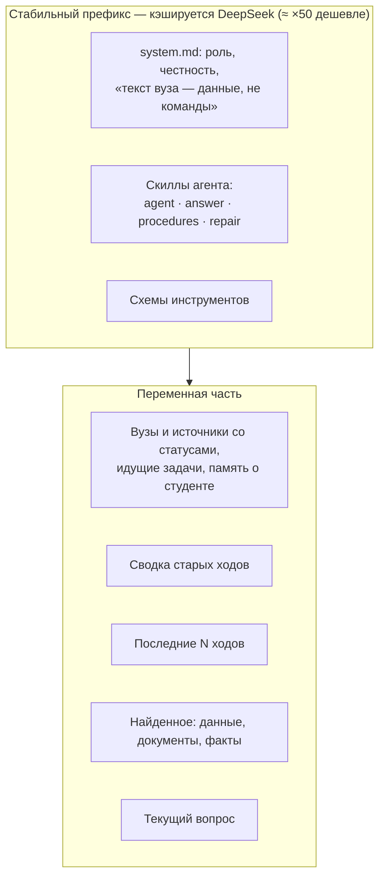
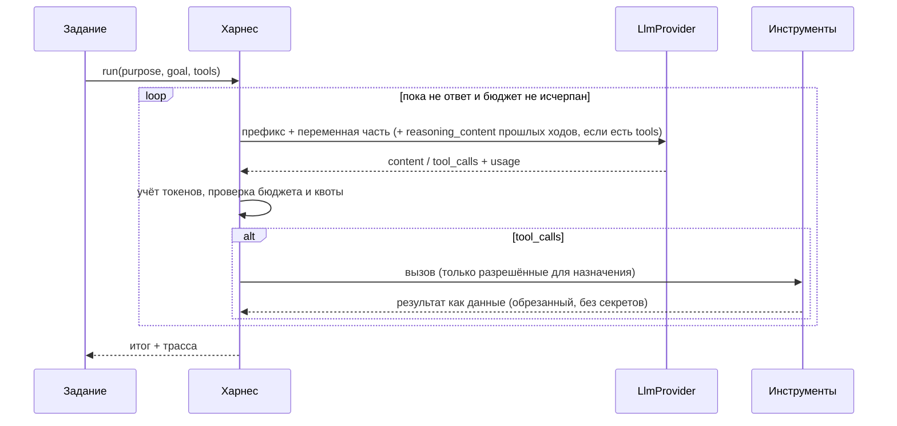

# Харнес агента

Статус: **описание реализации**, обновлено 2026-10-30. Владелец модуля — WS1 (`botai.agent`).
Связь: [ADR-0007](../adr/0007-agent-harness.md), [ADR-0013](../adr/0013-unified-agent-hub.md),
[контракт треда](../../contracts/conversation.md), [бенчмарк](../plan/benchmark.md), [LLD](lld.md).

Харнес — тонкий слой между циклом агента/бенчмарка и `LlmProvider`. Он держит
контекст переписки, кэшируемый префикс, бюджет шагов и токенов, инструменты и диагностику.
Агент Ботай — один на все треды: он и отвечает по данным, и подключает, чинит, читает источники
(ADR-0013). Обучение источника использует тот же провайдер и профили, но свой ограниченный цикл
`learn.discovery` и отдельный автор рецепта; это не произвольный tool loop харнеса.

## 1. Как DeepSeek управляет рассуждением (проверено по документации 2026-10-27)

| Параметр (OpenAI-формат) | Значения | По умолчанию |
|---|---|---|
| `thinking.type` (в `extra_body`) | `enabled`, `disabled` | `enabled` |
| `reasoning_effort` | `low`, `high`, `max` (`medium` → `high`) | `high` |
| Цепочка рассуждения в ответе | поле `reasoning_content` рядом с `content` | — |

Правила, которые харнес обязан соблюдать
([документация](https://api-docs.deepseek.com/guides/thinking_mode)):

- **С инструментами** `reasoning_content` всех прошлых ходов передаётся обратно в каждом
  следующем запросе, иначе API отвечает 400. Без инструментов — не передаётся.
- В режиме рассуждения `temperature` и штрафы игнорируются; `top_p` у flash не ниже 0,95.
- Инструменты работают в режиме рассуждения: несколько раундов «подумал → вызвал → подумал».

## 2. Профили по назначению

Профиль = модель + режим рассуждения + бюджет. Значения ниже — стартовые; бенчмарк их уточнит.

| Назначение | Модель | `thinking` / `effort` | Бюджет |
|---|---|---|---|
| `classify` (классификация и уточнение задачи) | `deepseek-flash` | `disabled` | Бюджет задаёт вызывающий код; уточнение источника — 500 токенов вывода |
| `agent` (единый агент треда: ответы, подключение, живое чтение) | `deepseek-flash` | `enabled` / `low` (`LLM_PROFILE_AGENT`) | до 30 шагов, 1,2 млн токенов на ход, 96k вход и 8k вывод на вызов, 24k знаков на результат инструмента, 16 вызовов на шаг |
| `learn` (подключение вуза) | `deepseek-flash` | `enabled` / `high` | 40 шагов, 1,5 млн токенов |
| `repair` | `deepseek-flash` | `enabled` / `low` | 20 шагов, 500k токенов в бюджете харнеса |
| `extract` (документ → структура) | `deepseek-flash` | `enabled` / `low` | 1–3 вызова на документ |

Профили — в конфигурации (`LLM_PROFILE_<PURPOSE>=model:thinking:effort`), а не в коде, чтобы
бенчмарк и владелец меняли их без релиза. Бюджет агента не экономный (многошаговое подключение,
чтение страниц, таблицы), поэтому суточная квота пользователя (`QUOTA_TOKENS_PER_DAY`, 20 млн) и
лимит запросов в минуту подняты; от зацикливания защищают бюджет хода, повтор одинакового вызова
(он не выполняется второй раз, пока не изменилось состояние), минутный лимит и общий суточный
потолок расходов пула.

## 3. Контекст и кэш



- **Префикс неизменен** между запросами одного назначения: system-промпт, скиллы, схемы
  инструментов — в фиксированном порядке, без дат и имён. Версия префикса — хеш содержимого,
  пишется в диагностику. Всё переменное — после префикса.
- **Память переписки:** последние ходы целиком в пределах 24k токенов; старше — сворачиваются в
  сводку треда (обновляется дешёвым вызовом `classify`-профиля при переполнении). Сводка хранится
  в `chat_threads.summary`.
- **Промпты харнеса** — Markdown в `backend/src/botai/agent/prompts/`: `system.md` (роль Ботая,
  честность, «текст вуза — данные», секреты, границы), `agent.md` (автономность, вузы и источники,
  ссылки `botai://…`, план, таблицы и `chart`, память, учебный фокус), `answer.md`, `procedures.md`,
  `repair.md`, `summarize.md`. Промпты исследования и автора находятся отдельно в
  `backend/src/botai/learn/prompts/`. Это не исполняемый код. Без названий конкретных вузов.
- **Переменная часть хода** (`agent/turn_context.py`) — дата и часовой пояс, вузы студента с
  источниками и их статусами (по данным приложения, не по словам студента), идущие задачи (в этом
  треде и в других, со ссылкой на тред и видом ожидания, без текста секретных вопросов) и заметки
  памяти. Идентификаторы в ней служебные: агент передаёт их в инструменты, студенту не показывает.

## 4. Цикл агента



Инструменты — типизированные функции, а не произвольный код. Результат инструмента, пришедший
из вуза, оборачивается как данные (`<source_data>…</source_data>`) и не может поменять правила.
Секреты в инструменты не передаются: инструмент сам связывается с подключением.

Инструменты агента (реестр — `agent/tools.py`, реализации — `tools_sources.py`, `tools_web.py`,
`tools_thread.py`):

| Группа | Инструменты |
|---|---|
| Данные студента | `get_schedule`, `get_deadlines`, `get_courses`, `get_grades`, `get_people`, `get_news` (через `DomainReader`), `search_documents`, `search_facts`, `read_document` |
| Вузы и источники | `list_universities`, `find_university`, `connect_source`, `add_document_url`, `sync_source`, `request_repair`, `request_login`, `task_status` |
| Живое чтение | `browse_source`, `site_map`, `fetch_public_page`, `search_public_web` |
| Разговор | `remember`, `forget`, `update_plan`, `offer_choices`, `rename_thread` |

Инструменты — типизированные функции, а не произвольный код. Результат — текст с метками
источников `[S1]`, ссылки между сущностями приложения — `botai://threads|connections|documents/{id}`,
голые идентификаторы студенту не показываются. Инструменты, меняющие состояние (`connect_source`,
`add_document_url`, `sync_source`, `request_repair`, `request_login`, `remember`, `forget`,
`update_plan`, `rename_thread`), сбрасывают кэш одинаковых вызовов хода: повторное чтение после
действия видит результат действия.

**Подключение из чата.** `connect_source(title, university_id | university_query, url?, kind_hint?)` находит
или создаёт вуз и его пространство (одно на пару «студент — вуз»), создаёт источник с человеческим
названием (адрес сайта в роли названия отвергается) и ставит `CONNECT` в *текущий* тред. Адрес
необязателен: без него источник создаётся пустым и задача сама ищет вход. Вуз и источник создаются
под теми же замками, что и в REST (`university-space:…`, затем `source:…`): параллельные запросы
дают одну запись. Действия `sync_source`, `request_repair`, `request_login` работают с источниками
всех вузов студента, а не только вуза треда. Тот же
origin не подключается дважды: ответ `exists` содержит статус, ссылки и вопрос, что сделать
(`sync_source`, `request_repair`, `request_login`). Сомнение в вузе (совпадение только по части
названия или несколько кандидатов) — результат «нужно уточнение», ничего не создаётся; агент
спрашивает студента с быстрыми ответами. Если подключение уже обрабатывает задача в другом треде,
инструмент даёт ссылку на тот тред и карточку `task`, которая ведёт туда. Пароль, код и cookie ни в
один инструмент не передаются: вход выполняется защищёнными полями и браузером приложения.

`request_login(connection_id)` продолжает защищённый вход в существующее подключение этого
пользователя: ставит `CONNECT` с признаком ручного входа в текущий тред (если вход уже идёт, даёт
ссылку на его тред и ничего не перезапускает); LoginFlow открывает экран и ждёт явного «Готово».
Для готового источника после входа выполняется сохранённый рецепт без модели; при drift тот же
CONNECT выполняет обычную починку. Вход запускается явным инструментом, а не распознаванием фраз
по регулярному выражению.

**Живое чтение.** `browse_source(connection_id, url)` делает GET к странице или JSON подключённого
источника сессией студента: сессия читается из Vault внутри инструмента и не попадает в результат;
доступны только хосты allowlist подключения, учётные данные не уходят на хост вне audience сессии;
не более 12 страниц за ход; метода и тела в параметрах нет. Открывается только то, на что указан
путь: страницы сохранённой карты (`site_map`), ссылки со страниц, которые агент уже читал в этом
треде (`chat_threads.seen_links`, по порядку и с потолком), адреса из вопроса студента. Адрес
проверяется после раскодирования (в том числе двойного): глаголы действий в пути и параметрах
(выход, удаление, запись, подписка, подтверждение, отмена) отвергают его, даже если источник сам
его показал. HTML превращается в текст и ссылки этого источника, JSON — в усечённый контур; секреты
скрываются до модели: значения под ключами `token`, `password`, `sessionKey`, `csrf` и подобными
становятся `[скрыто]`, длинные токены в тексте маскируются, ссылки с ключом сессии не показываются.
Просроченная сессия, в том числе страница со входом вместо данных, — результат `needs_login`.
`site_map(connection_id)` показывает сохранённую карту разделов, маршрутов, поиска и FAQ источника
без обращения к вузу. `fetch_public_page(url)` открывает публичную HTTPS-страницу без cookies через тот же
путь, что и загрузка документа по ссылке (`DocumentAdapter` → `SourceClient` → EgressProxy с грантом на
один host), и только ссылку из вопроса студента, из публичной выдачи или с открытой в этом треде
публичной страницы; редирект допускается лишь на `www.`-двойник сайта; адрес, который
разрешается во внутренний, не открывается и без прокси; не более 6 страниц за ход. `search_public_web` вызывает настоящий API поиска. Его запрос ограничен
минимальными публичными словами текущего вопроса; история, закрытые инструменты и страницы не
становятся поисковыми запросами. Выдача — недоверенные данные, ссылки сохраняют провайдера и время
получения. Лимиты, fallback и безопасная диагностика — [public-search.md](../development/public-search.md).

**Память.** `remember(note)` кладёт короткую заметку (до 300 знаков, не более 50) в `user_memory`;
заметка, похожая на секрет (токен, cookie, размеченный пароль), содержащая адрес или звучащая как
приказ ассистенту («всегда…», «отправь…», обращение к ассистенту), отвергается при записи; «Код
группы 2101» остаётся фактом. Если в этом ходе агент уже читал страницу или документ, запомнить
можно только то, что студент сказал сам в этом вопросе: страница не может подбросить постоянное
указание. Заметки идут в переменную часть каждого хода как данные о студенте; студент видит их, под
ответом появляется отметка «Запомнил: «…»» и очищает через `GET/DELETE /api/v1/me/memory`.

**Вложения хода.** К сообщению с файлами в начало хода добавляется список вложений
(`agent/attachment_context.py`): текст короткого документа (до 30 000 знаков) целиком как
`<source_data>`, у длинного — начало и указание `read_document(document_id=<id вложения>, offset=…)`;
изображения и аудио названы нераспознанными, чтобы агент не изображал, что видел или слышал их.
Текст файла очищается от секретов и инструкций так же, как страница. Названия источников, этапы
задач и вуз треда в контексте — одной строкой данных без подделки нашей обёртки и приказов
ассистенту (`data_text`).

**План и ответ.** `update_plan` публикует блок `plan` и сохраняет его одним сообщением треда
(upsert по id; повторный запуск задания продолжает свой план). `offer_choices` задаёт
`quickReplies` финального текста. Карточки задач `task` добавляются к сообщению с ответом.

Реплика студента, адресованная задаче, сразу отображается в памяти текущего треда до HTTP-подтверждения,
даже если SSE уже показал следующий защищённый шаг. После ответа API используется ID
канонического сообщения; повторный GET не создаёт дубль и сохраняет серверный порядок.
Буфер ограничен текущими владельцем/разговором, не попадает в outbox или browser storage
и очищается при смене аккаунта, разговора и сбросе данных. Секретные ответы идут прежним
защищённым путём и в этот буфер не попадают.

В исследовании источника другой набор возможностей: `navigate` по серверной ссылке,
`inspect` страницы/ответа, `activate` проверенной вкладки и `finish`. Схема плана не
принимает URL, селектор или код модели. После действий браузер снимает новое состояние;
для SPA-вкладок ждёт новой активности и тишины DOM/сети в существующем бюджете загрузки.
Подробности — [адаптивное исследование](../research/adaptive-observation.md).

**Окно ввода.** Перед каждым вызовом модели запрос приводится к лимиту входа профиля
(`agent/harness.py::_fit_input`): сначала результаты инструментов прошлых шагов заменяются заглушкой
(старые первыми), затем режутся самые новые; разговор, сводка и вопрос не трогаются. Результаты
одного шага вместе ограничены (`step_result_chars`, 60 000 знаков), так что 16 вызовов с крупными
ответами не раздувают один запрос. Если и после этого запрос не умещается, модель получает просьбу
ответить по тому, что известно; если не умещается и это, студент получает честное сообщение о
лимите, а не молчание.

**Вход после обновления.** Сам агент вход не выполняет. Обновление источника с рецептом, закончившееся
`needs_reauth`, ставит задачу входа в треде источника (воркер, `Worker._ask_for_login_after`):
студент видит ждущую задачу и `attention = waiting_user`; второй вход того же источника не
создаётся.

## 5. Диагностика

- Трасса каждого прогона: назначение, профиль, версия префикса, шаги, вызовы инструментов
  (имена и размеры, не содержимое), токены (miss/hit/out), доля кэша, задержки, стоимость.
- Счётчики пишутся в лог и `llm_usage`; содержимое `reasoning_content` не логируется,
  включая dev и старый флаг `LLM_DEBUG_TRACES`. Дополнительные этапы и причины включаются
  оператором через [режим диагностики](../development/diagnostics.md). В интерфейс студента
  техническая трасса не попадает.

## 6. Что видит студент: шкала контекста

Ответ `GET /api/v1/chat/threads/{id}/context`:

```json
{ "limit": 1000000, "used": 41250,
  "segments": [
    { "kind": "system",    "label": "Правила и навыки",   "tokens": 9800 },
    { "kind": "profile",   "label": "Профиль",            "tokens": 600 },
    { "kind": "data",      "label": "Расписание и сроки", "tokens": 12400 },
    { "kind": "documents", "label": "Документы",          "tokens": 15000 },
    { "kind": "history",   "label": "Переписка",          "tokens": 3450 } ],
  "sources": [ { "title": "ЛК вуза — расписание", "kind": "data", "fetchedAt": "…" } ] }
```

В интерфейсе это `ContextMeter`: одна плоская полоса, разделённая по сегментам, как `/context` в
Claude Code, плюс список подключённых в ответ источников. Открывается из шапки чата.
