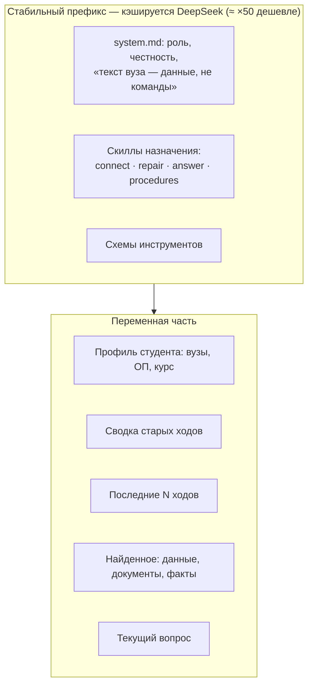
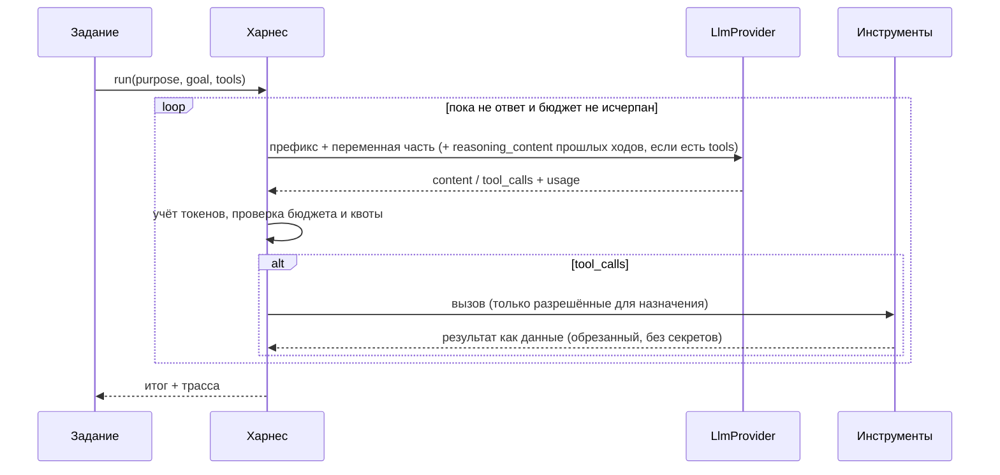

# Харнес агента

Статус: **accepted**, 2026-10-27 (запрос владельца). Владелец модуля — W5 (`botai.agent.harness`).
Связь: [ADR-0007](../adr/0007-agent-harness.md), [бенчмарк](../plan/benchmark.md), [LLD](lld.md).

Харнес — тонкий слой между заданиями (обучение вуза, починка, чат) и `LlmProvider`. Он держит
контекст переписки, кэшируемый префикс, бюджет шагов и токенов, инструменты и диагностику.

## 1. Как DeepSeek управляет рассуждением (проверено по документации 2026-10-27)

| Параметр (OpenAI-формат) | Значения | По умолчанию |
|---|---|---|
| `thinking.type` (в `extra_body`) | `enabled`, `disabled` | `enabled` |
| `reasoning_effort` | `low`, `high`, `max` (`medium` → `high`) | `high` |
| Цепочка рассуждения в ответе | поле `reasoning_content` рядом с `content` | — |

Правила, которые харнес обязан соблюдать
([документация](https://api-docs.deepseek.com/guides/thinking_mode)):

- **С инструментами** `reasoning_content` всех прошлых ходов передаётся обратно в каждом
  следующем запросе, иначе API отвечает 400. Без инструментов — не передаётся.
- В режиме рассуждения `temperature` и штрафы игнорируются; `top_p` у flash не ниже 0,95.
- Инструменты работают в режиме рассуждения: несколько раундов «подумал → вызвал → подумал».

## 2. Профили по назначению

Профиль = модель + режим рассуждения + бюджет. Значения ниже — стартовые; бенчмарк их уточнит.

| Назначение | Модель | `thinking` / `effort` | Бюджет |
|---|---|---|---|
| `classify` (тип вопроса в чате) | `deepseek-flash` | `disabled` | 1 вызов, 300 токенов вывода |
| `chat` (ответ по найденным данным) | `deepseek-flash` | `enabled` / `low` | 6 шагов, 32k вход |
| `learn` (подключение вуза) | `deepseek-flash` | `enabled` / `high` | 40 шагов, 1,5 млн токенов |
| `repair` | `deepseek-flash` | `enabled` / `high` | 20 шагов, 500k токенов |
| `extract` (документ → структура) | `deepseek-flash` | `enabled` / `low` | 1–3 вызова на документ |

Профили — в конфигурации (`LLM_PROFILE_<PURPOSE>=model:thinking:effort`), а не в коде, чтобы
бенчмарк и владелец меняли их без релиза.

## 3. Контекст и кэш



- **Префикс неизменен** между запросами одного назначения: system-промпт, скиллы, схемы
  инструментов — в фиксированном порядке, без дат и имён. Версия префикса — хеш содержимого,
  пишется в диагностику. Всё переменное — после префикса.
- **Память переписки:** последние ходы целиком в пределах 24k токенов; старше — сворачиваются в
  сводку треда (обновляется дешёвым вызовом `classify`-профиля при переполнении). Сводка хранится
  в `chat_threads.summary`.
- **Скиллы** — Markdown в `backend/src/botai/agent/prompts/`: `system.md`, `connect.md`,
  `repair.md`, `answer.md`, `procedures.md`. Это не код: процедура действий и правила для модели.
  Без названий конкретных вузов.

## 4. Цикл агента



Инструменты — типизированные функции, а не произвольный код. Результат инструмента, пришедший
из вуза, оборачивается как данные (`<source_data>…</source_data>`) и не может поменять правила.
Секреты в инструменты не передаются: инструмент сам связывается с подключением.

## 5. Диагностика

- Трасса каждого прогона: назначение, профиль, версия префикса, шаги, вызовы инструментов
  (имена и размеры, не содержимое), токены (miss/hit/out), доля кэша, задержки, стоимость.
- Счётчики пишутся в лог и `llm_usage`; содержимое `reasoning_content` не логируется,
  включая dev и старый флаг `LLM_DEBUG_TRACES`. Дополнительные этапы и причины включаются
  оператором через [режим диагностики](../development/diagnostics.md). В интерфейс студента
  техническая трасса не попадает.

## 6. Что видит студент: шкала контекста

Ответ `GET /api/v1/chat/threads/{id}/context`:

```json
{ "limit": 1000000, "used": 41250,
  "segments": [
    { "kind": "system",    "label": "Правила и навыки",   "tokens": 9800 },
    { "kind": "profile",   "label": "Профиль",            "tokens": 600 },
    { "kind": "data",      "label": "Расписание и сроки", "tokens": 12400 },
    { "kind": "documents", "label": "Документы",          "tokens": 15000 },
    { "kind": "history",   "label": "Переписка",          "tokens": 3450 } ],
  "sources": [ { "title": "ЛК вуза — расписание", "kind": "data", "fetchedAt": "…" } ] }
```

В интерфейсе это `ContextMeter`: одна плоская полоса, разделённая по сегментам, как `/context` в
Claude Code, плюс список подключённых в ответ источников. Открывается из шапки чата.
