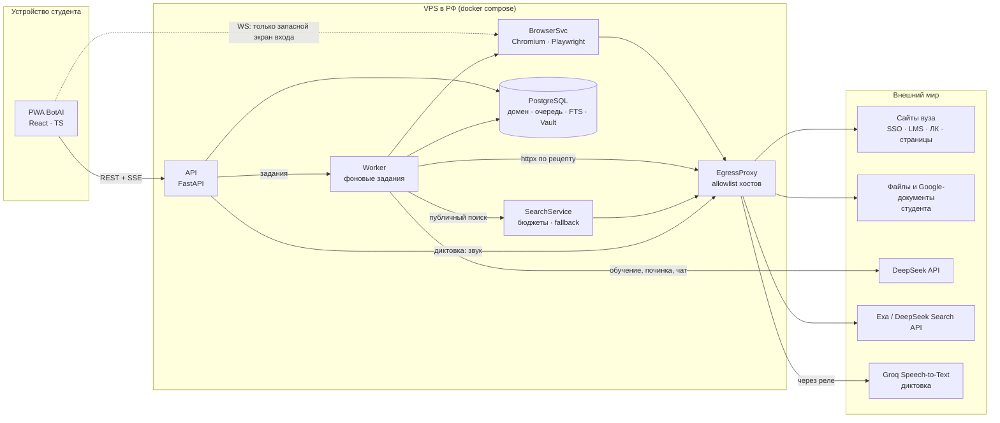
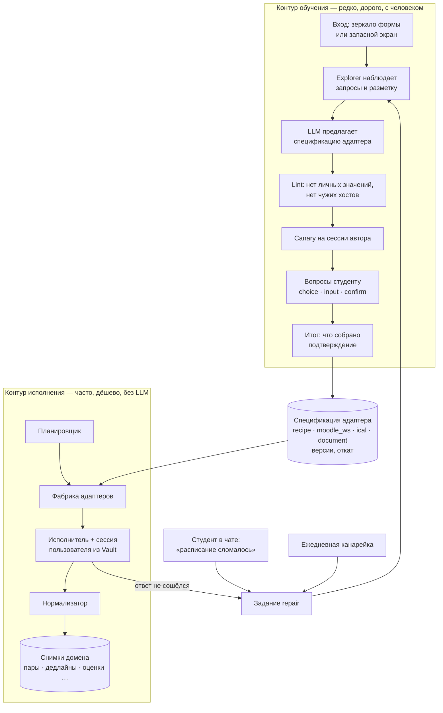
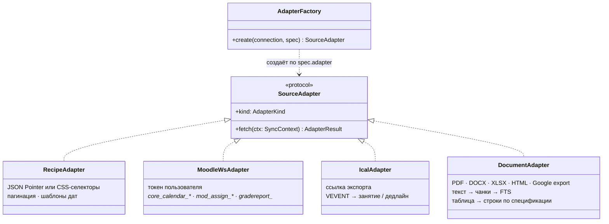
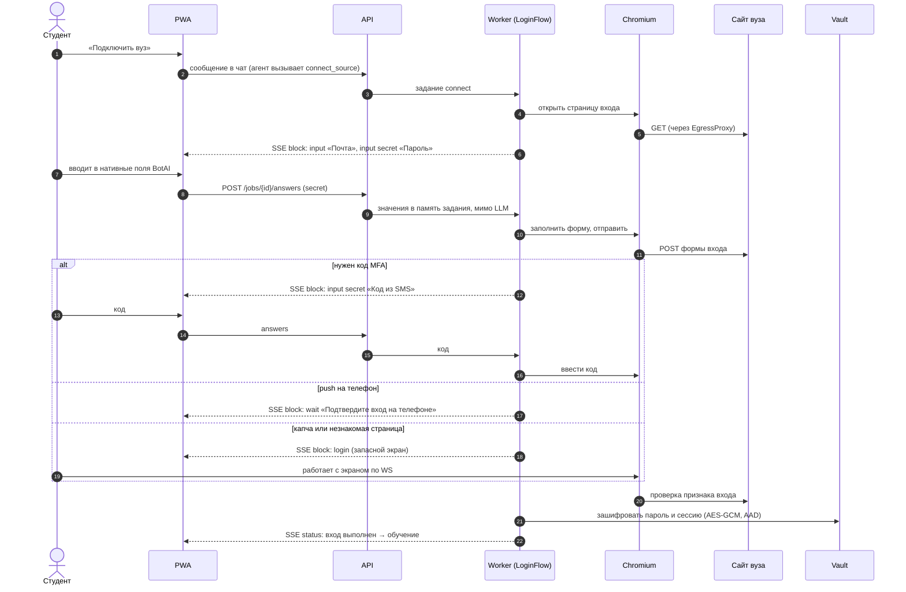
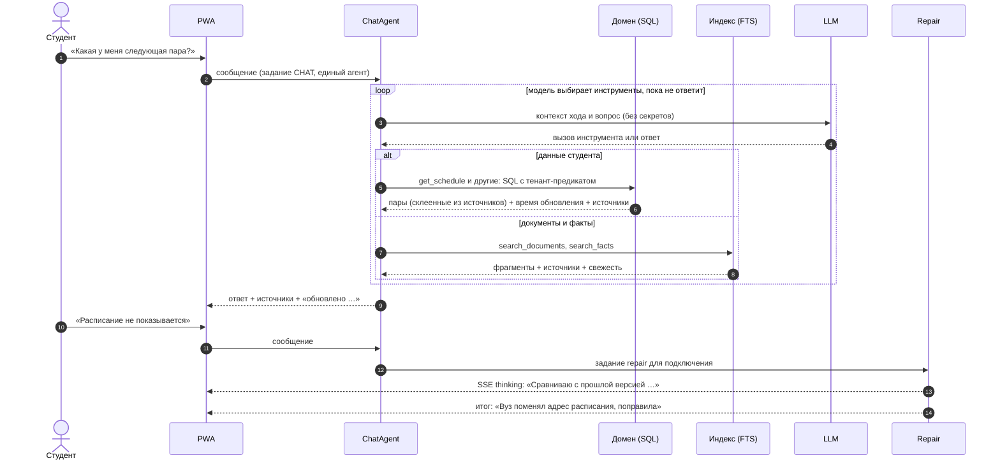
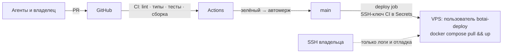

# BotAI — High-Level Design

Статус: **описание реализации**, обновлено 2026-10-31. Диаграммы — Mermaid: открываются в превью Markdown в IDE и на
GitHub. Детали модулей — [LLD](lld.md). Почему так — [ADR](../README.md#решения).

Принятое направление рефакторинга — [возобновляемое исследование](source-research.md):
существующая очередь Job, зашифрованный checkpoint в том же Postgres и свежий браузер
при продолжении. Это реализовано; статус этапов — в [плане](../plan/source-research-refactor.md).

## 1. Система целиком

Два правила, на которых держится всё остальное:

- **Источники и публичный поиск — через EgressProxy.** Allowlist источника привязан к
  подключению; поиск получает отдельное разрешение только для фиксированного API провайдера.
  Существующий LLM-провайдер использует отдельный фиксированный путь DeepSeek, который
  не получает URL из модели или источника. Поисковая выдача не расширяет доступ к вузу.
- **Секреты — только в Vault.** В LLM уходят данные и вопросы, но не пароль, cookie или токен.

## 2. Два контура

## 3. Фабрика источников (ADR-0005)

Вуз и документ — это данные (спецификация), а не код. Агент пишет спецификацию, но **никогда не
пишет исполняемый код**: текст со страницы вуза не может стать кодом на сервере.

## 4. Вход в вуз (ADR-0001)

## 5. Чат и самопочинка

Агент один на все треды; остальные его инструменты (подключение, живое чтение источника, публичный поиск, память) —
в [харнесе агента](agent-harness.md).

## 6. Развёртывание

Деплой выполнен (сервер подготовлен 2026-10-27, дальше выкладывается каждый зелёный `main`): порядок, откат и проверки после выпуска —
[deployment.md](../plan/deployment.md). До выкладки всё проверяется локально и в CI на фикстурах.
