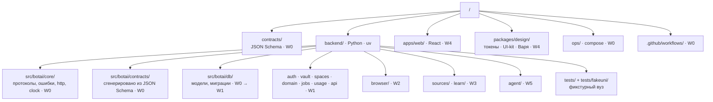
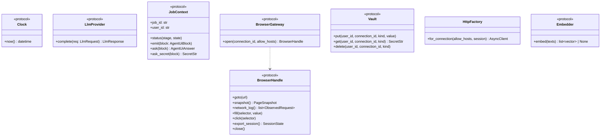
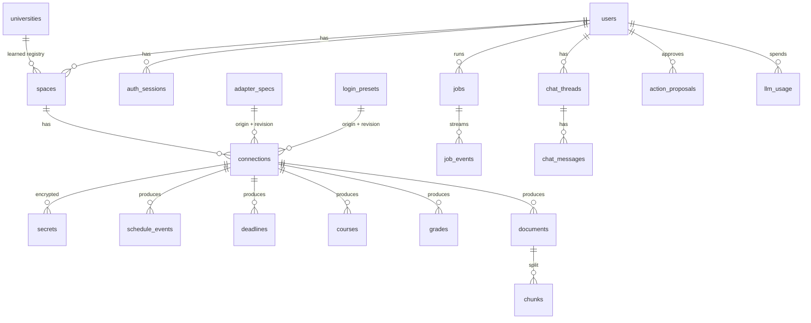
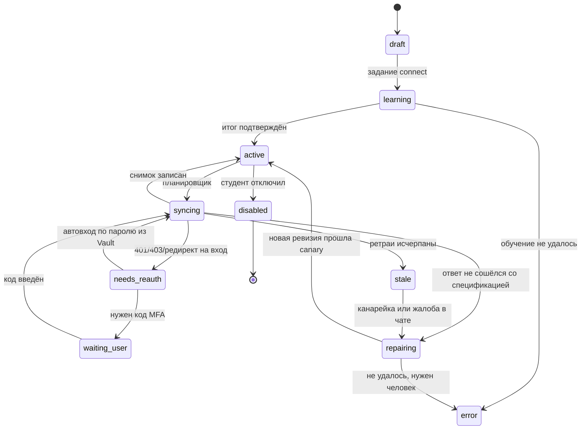
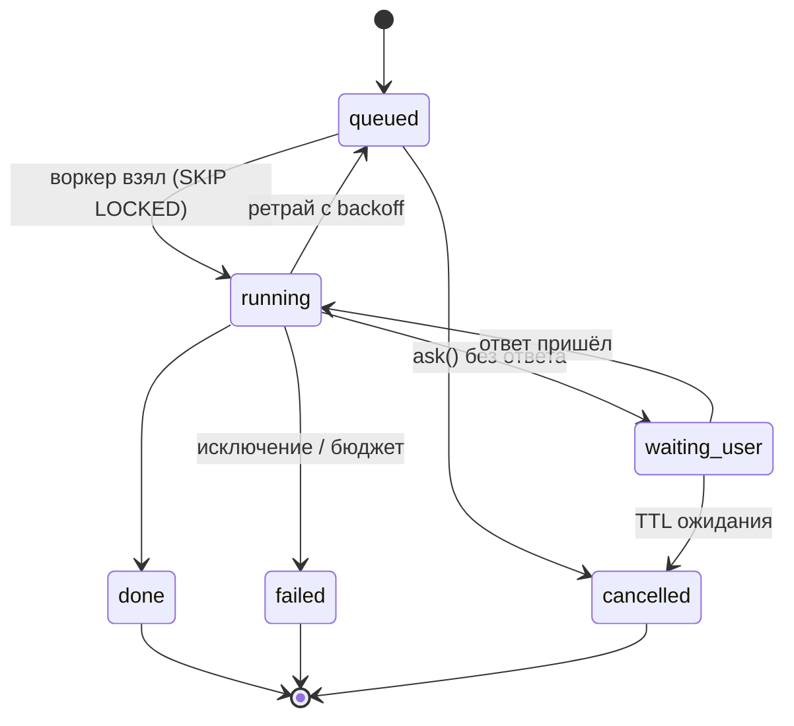

# BotAI — Low-Level Design

Статус: **описание реализации**, обновлено 2026-10-29. Модули, интерфейсы, таблицы и состояния. Это карта для
пяти параллельных потоков работ: у каждого модуля один владелец ([план](../plan/workstreams.md)).
Общая картина — [HLD](hld.md).

Принятое дополнение от 29.10.2026 — [LLD длительного исследования](source-research.md):
Job claim fencing, зашифрованный checkpoint, frontier и кандидаты после перезапуска,
кооперативное продолжение и общие бюджеты. [План](../plan/source-research-refactor.md)
разделяет целевую архитектуру и реализованные этапы.

## 1. Раскладка репозитория

| Модуль | Владелец | Отвечает за |
|---|---|---|
| `core` | W0 | `Clock`, `ids` (ULID), `errors` (problem+json, коды), `http` (клиент с таймаутами и ретраями через прокси), `logging` (redaction), протоколы `LlmProvider`, `JobContext`, `BrowserGateway`, `Vault`, `Embedder` и их тестовые реализации |
| `contracts` | W0 | Pydantic-модели, сгенерированные из `contracts/*.schema.json`; руками не правятся |
| `db` | W0, затем W1 | SQLAlchemy-модели всех таблиц и миграции Alembic. Новая колонка — PR владельца W1 |
| `api` | W0 (каркас), W1 | `create_app()`, подключение роутеров всех модулей, зависимости `current_user`, `db_session` |
| `auth`, `vault`, `spaces`, `domain`, `jobs`, `usage` | W1 | Приглашения и сессии, шифрование, пространства и подключения, чтение домена, очередь и SSE, квоты |
| `browser` | W2 | Пул Chromium, LoginFlow (зеркало формы), запасной экран (WS), снятие сессии, EgressProxy |
| `sources` | W3 | Фабрика адаптеров, `recipe` (JSON и HTML), `moodle_ws`, `ical`, `document`, Runner, Normalizer, планировщик sync |
| `learn` | W3 | Explorer, lint спецификаций, canary, версии и откат, repair |
| `agent` | W5 | DeepSeek-провайдер, чат, классификация вопроса, инструменты только на чтение, поиск FTS, факты, ActionBroker |
| `search` | W5 | Публичный Web Search, privacy gate, Exa/DeepSeek, deadline/retries/cooldown, нормализация и учёт |
| `apps/web`, `packages/design` | W4 | PWA, дизайн-система, Варя |

## 2. Ключевые интерфейсы (`botai.core`)

Все модули зависят от протоколов, а не друг от друга. Поэтому потоки W1–W5 пишутся параллельно:
у каждого протокола в `core` есть тестовая реализация.

| Протокол | Тестовая реализация в `core` | Боевая реализация |
|---|---|---|
| `Clock` | `FrozenClock` | `SystemClock` |
| `LlmProvider` | `ScriptedLlm` — ответы из фикстур по хешу запроса, падает на неизвестном | `agent.llm.DeepSeekProvider` (W5) |
| `JobContext` | `InMemoryJobContext` — заранее заданные ответы на блоки | `jobs.PgJobContext` (W1) |
| `BrowserGateway` | `FakeBrowserGateway` — страницы из словаря | `browser.PlaywrightGateway` (W2) |
| `Vault` | `InMemoryVault` (тот же AES-GCM, ключ из теста) | `vault.PgVault` (W1) |
| `Embedder` | `NoopEmbedder` | решается после VPS (ADR-0006) |

## 3. Данные

Правила для всех таблиц с данными пользователя:

- есть `user_id`; любое чтение идёт через репозиторий, который принимает `user_id` первым
  обязательным аргументом (тенант-предикат, NFR-001);
- доменные таблицы: `connection_id`, `external_id`, `source_url`, `fetched_at`, `spec_rev`;
  уникальность `(connection_id, external_id)`; upsert идемпотентен;
- `secrets`: `kind ∈ {password, login, session, token, ical_url, api_key, llm_key, transient}`,
  колонки `kek_id`, `wrapped_dek`, `nonce`, `ciphertext`, `aad_version`, `expires_at`;
  plaintext не хранится нигде;
- `universities` — **выученный** реестр (название, origins, акцент), а не список в коде.

`connections.data_scope` — внутренняя nullable JSONB-колонка миграции `9c2a7184be6d`.
`NULL` сохраняет auto/legacy-чтение общей спецификации; список видов ограничивает
запросы конкретного подключения, `[]` закрывает чтение. Эффективная копия рецепта
фильтруется до fetch и повторно перед commit; общая ревизия не меняется из-за сужения
пользовательской области. Миграция и ограничения отката —
[deployment.md](../plan/deployment.md).

Полные столбцы — в `backend/src/botai/db/models.py` (источник правды) и миграциях.

## 4. Состояния

### Подключение

### Задание

## 5. Таймауты и ретраи (NFR-017)

Пользователь не видит кнопок «Повторить»: всё ниже происходит в фоне, интерфейс показывает
маленький индикатор или Варю.

| Уровень | Таймаут | Ретраи | Когда не ретраим |
|---|---|---|---|
| HTTP-запрос к вузу | connect 5 с, read 20 с, всего 30 с | 3, backoff 0,5 · 2 · 8 с + jitter; `Retry-After` до 60 с | 400–404 кроме 408/429; признак протухания сессии |
| Шаг браузера | навигация 30 с, ожидание элемента 10 с | 2 | Капча, защита от ботов — сразу к человеку |
| Задание sync | бюджет 120 с | 3 на уровне задания: через 1, 5, 30 мин | `needs_reauth` → автовход; затем `stale` + repair |
| Вызов LLM | 60 с, стрим — 15 с между чанками | 2 на 5xx/429/таймаут | 4xx запроса; превышение квоты |
| Публичный поиск | общий deadline 15 с, попытка ≤5 с | ≤2 попыток на провайдера; всего ≤4 по умолчанию | 429 → cooldown/fallback; ключ/кредиты/конфигурация → отдельная причина |
| Адаптивное исследование | 90 с, 10 действий, 12 представлений, 200 запросов, 150k токенов | ограниченный fallback при недоступном планировщике | неполный проход не объявляет данные отсутствующими |
| Задание обучения | 40 шагов агента и 1,5 млн токенов | нет: при исчерпании — вопрос студенту | — |
| Ожидание ответа студента | 30 мин, затем задание `cancelled` с сохранённым прогрессом | — | — |

## 6. Поток событий задания

`job_events` пишутся в Postgres и раздаются по SSE (`GET /api/v1/jobs/{id}/events`), см.
[events.md](../../contracts/events.md). Ответы на блоки — `POST /api/v1/jobs/{id}/answers`.
Секретные ответы (`input.secret: true`) API сразу кладёт в Vault как `transient` с TTL 10 мин;
воркер забирает их через `JobContext.ask_secret()` и удаляет. В `job_events` и логах их нет.

## 7. Процессы

| Процесс | Команда | Что внутри |
|---|---|---|
| `api` | `uvicorn botai.main:app` | REST, SSE, WS запасного экрана |
| `worker` | `python -m botai.worker` | Задания: connect, learn, sync, repair, ingest, chat, action; планировщик sync |
| `browser` | внутри `worker` (MVP) | Пул Chromium; выносится в отдельный процесс, когда понадобится |
| `proxy` | `python -m botai.browser.proxy` | Фильтрующий CONNECT-прокси с allowlist |
| `postgres` | compose | Домен, очередь, FTS, Vault |
