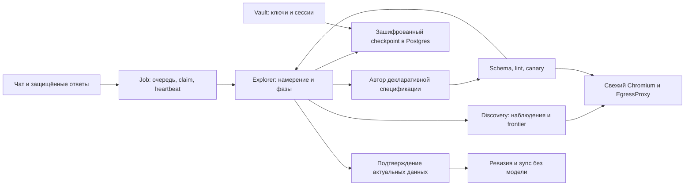

# Длительное исследование источника: HLD и LLD

Статус: **accepted design**, 29.10.2026; первый этап подготовлен в рабочей ветке по
[плану этапов](../plan/source-research-refactor.md). [ADR-0011](../adr/0011-resumable-source-discovery.md).
Текущие исправления передачи сессии и canary сохраняются. Ниже целевое поведение;
приёмка каждого реализованного этапа фиксируется отдельно.

## Компоненты и владение

- W1: Job, владение claim, checkpoint storage, TTL, tenant isolation, CAS и транзакции.
- W2: браузерные capabilities и защищённая публикация актуальной сессии.
- W3: фазы исследования, валидируемое состояние, восстановление frontier, диагностика
  гипотез и повторная проверка кандидатов.
- W0: внутренние capability protocols и additive migration. Публичный recipe v1 не меняется.
- W4/W5 продолжают существующие чат, события и подтверждения. Новая очередь/сервис не нужны.

## Единственный владелец выполнения

`Job` хранит состояние очереди. Claim token — снимок `id/user_id/locked_by/attempts` после
захвата. Валиден только в `running|waiting_user` при точном совпадении всех полей.
Переход в `queued`, отмена, удаление и новый claim немедленно отзывают прежний токен.
Истечение lease приводит к recovery; само течение времени не создаёт второго владельца.

Проверка выполняется под row lock в транзакции checkpoint, события, статуса, получения
ответа, публикации сессии, активации ревизии и записи снимка. Потеря claim — внутренний
`JobClaimLost`, без нового публичного error code и без cleanup состояния нового владельца.
Heartbeat тоже сравнивает поколение, включая повторный захват тем же именем worker.

Порядок существующих блокировок сохраняется: source advisory locks → Space/Connection →
Job → Thread/checkpoint. Если операция не пишет Connection/Space, она не берёт их после Job.
Нельзя держать DB-транзакцию во время браузера, LLM, MFA или ожидания пользователя.
Для общей ревизии origin lock берётся до Connection. Все guards предшествуют mutation/flush.

При нескольких процессах worker один пользователь не должен одновременно получить два
исследовательских браузера. Claim исследовательского задания сериализуется по пользователю
и проверяет другие активные задания источников, включая sync; ожидание ресурса сохраняет `queued`.
Это дополнение к process-local browser lock, а не замена tenant isolation.

## Хранилище

`job_research_checkpoints` содержит `job_id` (PK/FK), `user_id`, `connection_id`, `revision`,
`format_version`, `intent_key`, `updated_at`, `expires_at`, а также `kek_id/wrapped_dek/nonce/
ciphertext/aad_version` в принятом формате Vault. FK удаляют запись с Job/Connection/User.
`revision` положительна и увеличивается через compare-and-swap ожидаемой версии.

AAD связывает ciphertext с пользователем, job и отдельным `SecretKind.RESEARCH`;
зашифрованный envelope дополнительно содержит connection, format/engine version и intent key.
Все эти значения проверяются при загрузке. Шифрование/расшифровка остаются внутри Vault.
Checkpoint не возвращается в API, SSE, prompt или обычные диагностические журналы.

Начальные проектные пределы: до 512 КиБ на checkpoint и TTL 24 часа с последней публикации;
это ограничения,
не измерение потребления. Oversize, неизвестная версия или повреждённый ciphertext дают
явный технический отказ. Истечение TTL означает новое исследование с сохранённым намерением,
без утверждения, что прежний frontier восстановлен. В первом этапе накопительные бюджеты
хранятся в этом же checkpoint: после его удаления по TTL счётчики нового исследования
начинаются заново, хотя Job остаётся прежним. Это ограничение, а не восстановление прежнего run;
сохранение пожизненного расхода Job вне TTL — отдельное усиление. Дневные quota модели остаются
независимым ограничением. Cleanup ограничен собственными записями.

## Сохраняемые знания и временный runtime

Строгий versioned envelope хранит:

- нормализованное намерение и его digest, origin/allowlist digest;
- точные проверенные адреса входа, visited и frontier с происхождением;
- дескрипторы выбранных страниц/ответов и отпечатки наблюдений;
- завершённые действия и типизированные отрицательные результаты;
- прошедшие schema/lint кандидаты по видам данных и их evidence descriptors;
- фазу и счётчики времени, шагов, запросов, токенов, ошибок и неопределённых вызовов.

Первый этап хранит frontier, visited, evidence URLs, отрицательные результаты, кандидатов
и бюджеты. Полные fingerprints действий и богатая диагностика гипотез остаются следующими
этапами; чтение checkpoint не заменяет повторного наблюдения страницы.

Списки, строки и счётчики ограничены. Адреса приватны и зашифрованы, потому что редактированный
URL или hash нельзя превратить обратно в разрешённый адрес. После загрузки адрес снова проходит
валидацию origin/allowlist. Адреса с известными секретами, включая percent encoding,
отбрасываются до публикации checkpoint; актуальный inventory проверяется также перед
восстановлением. Отредактированный адрес не используется для replay. Политика не позволяет
модели придумывать адрес.

DOM, сырые network bodies, cookies, bearer, storage и секретные ответы в этот envelope не
копируются. Сессия отдельно в Vault. `p/r/l/t` references и ссылки на элементы принадлежат
только текущему BrowserHandle и не сериализуются. На восстановлении executor читает известные
страницы заново, строит новые references и проверяет auth до вызова модели.

Кандидат восстанавливается как предложение: lint и canary выполняются на свежем runtime.
Counts старой canary не становятся `Chosen.report.valid`. До commit активации после рестарта
нужны новая canary и новое подтверждение; изменившееся намерение или спецификация не покрыты
старым подтверждением. Первый этап не закрепляет вычисленный диапазон динамических шаблонов
дат: после состоявшейся активации sync вычисляет их заново, как обычное автообновление.
Отдельный range-binding относится к будущему контракту. Модель для уже сохранённого
кандидата повторно не вызывается, пока свежая проверка не потребует исправления.

## Фазы и продолжение

`observe → author → verify → confirm → activate` используют существующие LoginFlow, canary,
ревизии и Normalizer. `diagnose` возвращает исполненные findings в observe/author. Для waiting
human сохраняется намерение и знания; кадры/ввод/тикеты браузера остаются временными.

Каждый завершённый шаг публикует checkpoint. При исчерпании бюджета среза handler освобождает
браузер и кооперативно возвращает тот же Job в очередь. Это не транспортная ошибка и не расход
попытки повторения. Следующая фаза находится в зашифрованном checkpoint; crash между его
публикацией и requeue восстанавливается обычным orphan recovery того же Job.

`attempts` — поколение claim, не число ошибок. Число неудач retry считается отдельно;
успешные продолжения не исчерпывают четыре транспортные попытки. Пока checkpoint сохранён,
исследование имеет накопительные пределы независимо от числа рестартов; исключение TTL
описано выше. Начальные пределы сохраняют текущий бюджет 1800 с
активного времени и 1,5 млн токенов; discovery-срез ограничен 90 с/10 действиями.
Отдельный вызов автора или canary ограничен 300 с и оставшимся общим временем; ожидание
человека в исследовательское активное время не входит. Достижение discovery-среза
продолжает работу, достижение общего предела сохраняет честный неполный результат.

Commit завершённого model decision позволяет не повторять его после сбоя. Crash после
ответа провайдера до commit может потребовать повторного вызова: exactly-once для внешней
модели не заявляется. Для reads допустимо at-least-once; неопределённый вызов учитывается
в бюджете. Сеть и модель не находятся под DB lock.

После подтверждения активация рецепта и небольшая несекретная квитанция в Job записываются
одной транзакцией: intent digest, spec ID/revision/digest и виды. Если процесс остановился
после commit, продолжение сверяет квитанцию с текущим подключением и неизменённой активной
спецификацией, затем выполняет sync без повторного авторства и новой ревизии. Первый sync
закреплён за точными spec ID/revision/digest: совпадение проверяется до чтения и под origin
lock перед записью результата. Если другой пользователь уже активировал иную ревизию,
чужая версия не подставляется вместо подтверждённой и прежний снимок сохраняется. Изменившееся
намерение квитанцией не покрывается. Квитанция не содержит URL, данных или сессии и живёт
с Job независимо от TTL временных знаний.

API увеличивает внутренний input revision при приёме нового сообщения в inbox. Worker
запоминает revision прочитанного inbox; поздний commit сравнивает его с текущим значением
в строке Job. Защищённый вход использует отдельное внутреннее представление context:
новая реплика про область данных не отзывает уже запрошенные логин/MFA, а claim, tenant,
connection и отмена проверяются при каждом действии. Оно не перенимает revision этой
реплики и не ослабляет domain/research guards; Explorer обязан применить inbox после входа.
Исследование публикует сессию через обычный строгий context. Несовпадение возвращает тот же
Job к обработке уточнений, без транспортного
retry. Одного hash уже применённого intent недостаточно, потому что новое сообщение могло
появиться во время await модели.

Изменение intent/scope инвалидирует несовместимые кандидаты и proof. Новые пользовательские
сообщения обрабатываются до следующего дорогого действия и перед подтверждением/активацией.
Финальная запись проверяет версию применённого намерения; claim token сам по себе этого не даёт.

## Совместимость и следующие контрактные этапы

Additive migration не переписывает jobs, sessions или domain snapshots. Старые задания без
checkpoint начинают с существующего intent. Feature flag позволяет включить новый путь
отдельно; при выключении незавершённый новый run сохраняется и не исполняется старым путём.
Совместимый Worker пропускает неизвестную engine version и сохраняет новые runs при выключенном
feature flag. Откат на прежний binary, который не понимает marker, требует предварительной
остановки/парковки новых runs: одного flag недостаточно. Одновременная работа старых unfenced
workers и новых workers не поддерживается: перед rollout старые процессы должны
завершить/освободить задания. Downgrade безусловно удаляет новую таблицу и её содержимое,
поэтому тестируется только во временной БД; штатный rollback сохраняет данные и отключает
новые runs.

Следующие отдельные PR в `contracts/`: executor-owned auth bindings и cookie+bearer;
date/filter/pagination capabilities с контрактом replay; bounded flatten, parent context,
date/time composition и recurrence. До их приёмки обещать поддержку этих случаев нельзя.
Публичная спецификация остаётся общей на origin и не содержит личных значений.

Конфигурация первого этапа: `BOTAI_RESEARCH_ENABLED` (по умолчанию `false`),
`BOTAI_RESEARCH_SLICE_SECONDS=90`, `BOTAI_RESEARCH_SLICE_STEPS=10`,
`BOTAI_RESEARCH_MAX_SECONDS=1800`, `BOTAI_RESEARCH_MAX_TOKENS=1500000`,
`BOTAI_RESEARCH_MAX_STEPS=100`, `BOTAI_RESEARCH_MAX_REQUESTS=2000`,
`BOTAI_RESEARCH_CHECKPOINT_TTL_HOURS=24`. Максимальный размер ciphertext envelope —
512 КиБ. Пределы — проектные настройки, не обещанный срок или стоимость подключения.

Основа row locking — [документация PostgreSQL](https://www.postgresql.org/docs/17/explicit-locking.html).
Вывод о необходимости fencing относится к нашему lifecycle поверх коротких транзакций;
`SKIP LOCKED` сам по себе не отзывает работу процесса после завершения claim-транзакции.
