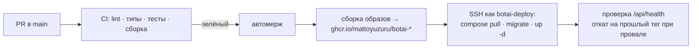

# Деплой на `mnema`

Статус: **действующий runbook**, обновлено 2026-10-29. Цель — только compose-проект
`botai` в `/srv/botai` на SSH alias `mnema`, публичный адрес https://botai.mnema.app.
Автодеплой разрешается `vars.DEPLOY_ENABLED=true`. Успешный деплой старого SHA не
доказывает текущую версию; результат выпуска фиксируется в [testing.md](../development/testing.md).

## Подготовка включения ADR-0011

С 2026-10-30 флаги `BOTAI_RESEARCH_ENABLED` и `BOTAI_FACTORY_V2_ENABLED` удалены: возобновляемое
исследование включено всегда (в production оба режима уже были включены). Compose передаёт
пределы `BOTAI_RESEARCH_*` API и worker. Обычный deploy сохраняет неизвестные ему параметры
`compose.vars`; в файле могут остаться строки удалённых флагов — они игнорируются. Не выводить файл
целиком: там пароль БД.

Текущий и предыдущий rollback-образ должны понимать marker engine 1 и
сохранять незавершённые checkpoints. Старый binary этого не умеет;
на него нельзя автоматически возвращать активные новые runs. Перед таким откатом нужны
остановка workers и явная парковка новых runs, с сохранением таблицы checkpoint. Смешанная
работа прежнего unfenced worker и нового worker не поддерживается.

Migration additive: добавляется `job_research_checkpoints`, существующие jobs, sessions и
учебные строки не переписываются. Штатный rollback сохраняет таблицу. Downgrade/re-upgrade
проверяются только во временной БД. Пределы, TTL и точный порядок блокировок —
[source-research](../architecture/source-research.md). Подготовка этих файлов не означает,
что новый путь включён или живые источники перепроверены.

## Выпуск factory v2: reader и producer вместе

С 2026-10-30 нет отдельных переключателей producer и исследовательского движка (флаги
`BOTAI_FACTORY_V2_ENABLED` и `BOTAI_RESEARCH_ENABLED` удалены, оба режима уже работали в
production). Автор создаёт v2, reader читает v1/v2. Worker получает 45 с на остановку контейнера при
внутреннем shutdown grace 20 с: это даёт время завершить/отменить задачи и сохранить checkpoint
до принудительного завершения.

1. Финальный интегрированный SHA проходит полный CI (включая generation, PG/Chromium/proxy,
   factory v2 E2E, web и guards). До зелёного результата выпуск не считать готовым.
2. Выпускается образ, который понимает recipe v2, engine marker, cumulative Job usage и
   миграции до `b5d1c8e7a42f`; проверяются revision labels, health, миграция и сохранность
   старых v1-подключений. Rollback-образ тоже должен понимать recipe v2.
3. Владелец выполняет ограниченный L3: вход, canary, нормализованный экран, повторный sync.
   Fixture success или API health не подтверждают поддержку университета.

Откат на pre-v2 binary после активации v2-рецептов требует остановки/парковки этих подключений
или адресного возврата проверенных v1-ревизий с сохранением domain snapshots. Сохранить таблицу
checkpoint, usage в Job и activation receipts; TTL cleanup знаний не является возвратом budget или
rollback. Автоматический backup/health rollback не решает семантическую несовместимость reader.
Фактический выпуск/откат фиксируется по SHA.

## Что сделано на сервере (2026-10-27)

| Что | Где |
|---|---|
| Пользователь `botai-deploy` | без пароля, группа `docker`, вход только ключом CI с `restrict` |
| Каталог | `/srv/botai` (`0750`), `backups/` |
| Секреты | `/srv/botai/app.secrets` (`0600`): `BOTAI_KEK`, `BOTAI_PROXY_SECRET` остаются на сервере; `DEEPSEEK_API_KEY`, `EXA_API_KEY`, `GROQ_API_KEY` поступают из GitHub Secrets по stdin SSH, без аргументов и вывода |
| Переменные compose | `/srv/botai/compose.vars`: `IMAGE_TAG`, `POSTGRES_PASSWORD`, `BOTAI_DIAGNOSTICS` |
| Бэкап | `/etc/cron.d/botai-backup`: `pg_dump` в 03:15, хранение 14 дней. **KEK в бэкап не входит**: без `app.secrets` сохранённые пароли вузов не расшифровать — студенты введут их заново |
| Caddy | блок `botai.mnema.app` в конце `/etc/caddy/Caddyfile`, бэкап `Caddyfile.bak-20261027-133201`, применён `reload`; TLS выпущен |
| GitHub | Secrets `DEPLOY_SSH_KEY`, `DEPLOY_HOST`, `DEPLOY_KNOWN_HOSTS`, `DEEPSEEK_API_KEY`, необязательные `EXA_API_KEY` и `GROQ_API_KEY`; Variable `DEPLOY_ENABLED` |

Скрипты: [bootstrap-server.sh](../../ops/deploy/bootstrap-server.sh) (один раз, идемпотентен),
[remote-deploy.sh](../../ops/deploy/remote-deploy.sh) (каждый деплой),
[compose.prod.yaml](../../ops/compose.prod.yaml), [deploy.yml](../../.github/workflows/deploy.yml).
Ручной деплой: Actions → deploy → Run workflow. Поле `diagnostics`: `keep` сохраняет
текущий режим, `on` включает подробные события, `off` выключает. Автодеплой режим не меняет.
Ручной запуск тоже требует текущий `main` с успешным push-CI. Candidate проверяется до
сборки и повторно перед rollout; более старый запуск не должен затереть новый `main`.
Workflow main сериализован, на сервере `.deploy.lock` сериализует также операторские
выкладки. Образ помечен полным `org.opencontainers.image.revision`; перед миграциями
скрипт сверяет его с ожидаемым полным SHA, а не только с коротким тегом.
При неудаче обновления скрипт возвращает прежние `IMAGE_TAG` и `BOTAI_DIAGNOSTICS` и проверяет
здоровье отката. Подробности и чтение по ID чата — [диагностика](../development/diagnostics.md).
Диагностический том `botai_diagdata` сохраняется при обновлении контейнеров; миграций БД
для этой функции нет. Отключить автодеплой: `gh variable set DEPLOY_ENABLED --body false`.

Поиск переключается `SEARCH_MODE=auto|off|exa|deepseek` и лимитами `SEARCH_*` в
`compose.vars`; Compose передаёт их в сервисы. Ключи никогда не находятся в этом
несекретном наборе настроек поиска или во frontend. Порядок провайдеров, ошибки и
smoke — [public-search.md](../development/public-search.md). `compose.vars` в целом
секретен, потому что содержит пароль БД: не выводить файл или `compose config` целиком.

Голосовой ввод (речь в текст, [speech-to-text.md](../development/speech-to-text.md)) работает через Groq.
`GROQ_API_KEY` — GitHub Secret, который `deploy.yml` отправляет пятой строкой stdin в `remote-deploy.sh`;
скрипт функцией `set_secret` заменяет одноимённую строку `app.secrets` (или добавляет её), а пустое значение и
отсутствующая строка (прежний порядок из четырёх строк) оставляют серверный ключ как есть. `app.secrets` читают
все сервисы Compose через `env_file`, поэтому в `compose.prod.yaml` ключа нет: там только несекретные
`STT_PROVIDER` (`groq` или `off`), `STT_MODEL`, `STT_LANGUAGE`, `STT_DEADLINE_S`, `STT_REQUESTS_PER_HOUR`,
`STT_SECONDS_PER_DAY`, которые меняются в
`compose.vars`. Без ключа или при `STT_PROVIDER=off` эндпоинт отвечает `503 stt_unavailable`, остальное
приложение не затронуто. Ключ в GitHub Secret ещё не ключ работающего контейнера: он доставляется следующим штатным
деплоем. Запросы к `api.groq.com` идут через EgressProxy с отдельным разрешением на этот хост. Тело запроса диктовки
ограничено тем же middleware, что и вложения (21 МиБ): лимит в Caddy `request_body { max_size 22MB }` из раздела ниже
покрывает и его.

### Размер загрузок

Файл вложения или документа — до 20 МиБ. Сервер сам ограничивает тело запроса загрузки
(`POST /api/v1/attachments`, `POST /api/v1/spaces/{id}/documents/upload`) числом 21 МиБ (файл
плюс служебные поля multipart) до того, как Starlette начнёт копировать его во временный файл:
по `Content-Length` отвечает `413` сразу, а тело без длины (chunked) считает и обрывает на
пределе (`attachments/limits.py`). Лимит приложения — последняя защита, не единственная: в блоке
Caddy `botai.mnema.app` поставьте `request_body { max_size 22MB }` (или эквивалент у другого
прокси), чтобы лишнее не доходило до контейнера, и не поднимайте этот предел выше без
пересмотра квоты вложений (512 МиБ на пользователя в Postgres).

### Точка восстановления перед миграцией

После pull/проверки образа и перед DDL `remote-deploy.sh` создаёт database-only `pg_dump -Fc`
в `backups/pre-TAG-UTC.dump.enc`, шифруя поток AES-256-CBC с PBKDF2. Отдельный случайный
ключ находится в `.rollback-keys/NAME.key` (`0600`); каталог имеет `0700`. Это не Vault
KEK. Ключ шифрования бэкапа, `app.secrets` и содержимое дампа не попадают в CI-артефакты
или вывод команд. Сбой dump/encryption останавливает выпуск до миграции.

Защищённый дамп считается проверенным только после расшифровки и восстановления в
отдельную временную БД с проверкой схемы и количества строк. Производственную БД для
такой пробы не заменяют. Ночной бэкап из первоначальной настройки и зашифрованная
точка перед миграцией — разные механизмы; не приписывать ночному бэкапу свойства
новой точки восстановления. Перед адресной очисткой аккаунта оператор отдельно
фиксирует состав удаления, backup/restore evidence и сохраняемые `users/auth_sessions`.

Для очистки одного аккаунта остановите API и worker BotAI, дождитесь завершения запросов (иначе
отправка из старой вкладки или ранее взятое задание создадут данные заново), проверьте
резервную копию и выполните в контейнере API (команда — [контракт сброса](../../contracts/account-reset.md)):

```
python -m botai.ops.reset_account --email E            # только числа по таблицам
python -m botai.ops.reset_account --email E --yes      # очистить одной транзакцией
python -m botai.ops.reset_account --email E --shared --yes   # и общее, чем больше никто не пользуется
```

Команда сама находит все таблицы с `user_id` (и зависимые `job_events/job_answers`), удаляет
секреты Vault пользователя, сохраняет `users`, `auth_sessions`, `invites`, `audit_log` и
`llm_usage` и пишет `product_data_reset`. `--shared` (в том же запуске, что очищает аккаунт)
удаляет рецепты, пресеты, карты сайтов и вузы, связанные с самим аккаунтом, и только если их не
использует никакой другой пользователь; чужие и ничьи записи не трогаются; справочник названий вузов и
ключи провайдеров не затрагиваются. Сначала запустите команду без `--yes` и сверьте числа с
ожидаемым составом; после `--yes` проверьте, что `/me` отдаёт `X-Botai-Data-Reset`, а вход
сохранён. Полный дамп для адресного отката сначала восстанавливают в отдельную БД и возвращают
только строки этого аккаунта и его зависимостей, сохраняя более новые и чужие данные production.

### Миграция пространств, источников и вложений `b7d3c91a5e24`

Следует за `e4a91b7c603d` (в общей цепочке потоков v3 стоит первой). Склеивает повторы
пространств одного вуза одного пользователя (и лишние «без вуза») в самое старое, перенося на
него подключения, документы, факты и треды; название пространства вуза берётся из
`universities`. Затем создаёт два частичных уникальных индекса, добавляет `connections.entry_url`,
переводит `kind` на новый словарь (`mail` → `other`, документ по ссылке → `doc`), заменяет
название источника, равное голому хосту его адреса, на название вида и создаёт таблицу
`attachments`. DDL ограничен `lock_timeout=5s`, `statement_timeout=60s`. Перед выкладкой нужен
свежий `pg_dump` и проверка на восстановленной копии: upgrade, число пространств до и после,
downgrade/re-upgrade. Downgrade убирает индексы, колонку и таблицу, но не разъединяет склеенные
пространства и не возвращает старые названия: откат образа без отката данных безопасен, откат
данных — только из дампа.

### Миграция области чтения `9c2a7184be6d`

Следует за `8148f6a927c3`; добавляет nullable JSONB `connections.data_scope`, без
переписывания старых строк. `NULL` сохраняет прежний auto/legacy-режим. DDL ограничен
`lock_timeout=5s`, `statement_timeout=30s`; upgrade/downgrade/re-upgrade проверяется на
одноразовой БД, а не на production.

Старый образ физически совместим с добавленной колонкой, но семантически не умеет
применять новые ограничения чтения. При откате на образ до этой функции сначала
приостановить sync подключений с `data_scope IS NOT NULL`; сохранить колонку и планировать
исправление вперёд. Downgrade удаляет выбор пользователя и не является штатным rollback.
После создания scoped-подключений одного отката образа недостаточно для безопасной
работы: старый код может снова читать все виды общей спецификации.

### Миграция диалогов `8148f6a927c3`

Миграция добавляет метаданные подключения и ключи идемпотентности в `chat_threads` и
`chat_messages`, уникальные ограничения и индекс. Существующие строки, секреты и снимки не
переписываются; старый образ совместим с добавленными полями. Перед выкладкой нужен свежий
`pg_dump` именно базы BotAI и проверка восстановления в отдельную временную БД: upgrade,
сравнение существующих строк, downgrade/re-upgrade и совпадение схемы с моделями. Содержимое
бэкапа и `app.secrets` в логи не выводятся; для проверки миграции KEK не нужен.

Индекс строится обычным DDL, поэтому проверяются размер таблиц, активные задания и граница
блокировки перед rollout. При сбое health-check возвращается предыдущий образ. После начала
новых разговоров поля сохраняются при откате образа: downgrade удаляет историю контекста и
ключи идемпотентности, поэтому штатное восстановление — исправляющая миграция вперёд.

## Что уже есть на сервере (снято read-only 2026-10-27)

| Параметр | Значение |
|---|---|
| Доступ | `ssh mnema` (пользователь `yuzuru`, группа `sudo`) |
| ОС | Ubuntu 24.04.4 LTS, ядро 6.8 |
| CPU | 6 vCPU, Intel Xeon Gold 6240R, **есть AVX512-VNNI** (int8-эмбеддинги ускоряются) |
| Память | 11 ГиБ, занято ≈ 1,5 ГиБ, swap нет |
| Диск | 119 ГБ, свободно 108 ГБ |
| Входящий трафик | **Caddy** на :80/:443, один `/etc/caddy/Caddyfile` с блоками `mnema.app`, `auth.`, `www.`, `admin.` |
| Занятые локальные порты | 13128, 15432, 18080, 18081, 18082 — **это Mnema, не трогать** |
| Docker | работает; в группе `docker` только `botai-deploy`; Mnema — проект `mnema-prod` в `/etc/mnema/production` |
| DNS | `botai.mnema.app` → IP сервера (проверено) |

## Принципы: не сломать Mnema

1. **Отдельный compose-проект** `botai` в `/srv/botai`, своя docker-сеть. Контейнеры Mnema и
   их сети не трогаем, `docker system prune` и подобное не запускаем.
2. **Один порт наружу из стека:** `127.0.0.1:18090` (API + статика PWA). Postgres BotAI — без
   публикации порта, только во внутренней сети compose. Порты 13128, 15432, 18080–18082 не
   занимаем.
3. **Caddy правится один раз и аккуратно:** копия `Caddyfile` → добавить блок
   `botai.mnema.app { reverse_proxy 127.0.0.1:18090 }` в конец → `caddy validate` → `systemctl
   reload caddy` (reload, не restart: живые соединения Mnema не рвутся). При ошибке валидации —
   откат из копии. CI в Caddy не ходит никогда.
4. **Лимиты ресурсов** в compose: Chromium и воркер ограничены по памяти (`mem_limit`), чтобы
   всплеск BotAI не задушил Mnema. Ориентир: весь стек BotAI ≤ 4 ГиБ.

## CI/CD



| Что | Как |
|---|---|
| Пользователь для CI | `botai-deploy`: без пароля и sudo, в группе `docker`, владелец `/srv/botai`, вход только по ключу CI |
| Секреты GitHub | `DEPLOY_SSH_KEY`, `DEPLOY_HOST`, `DEPLOY_KNOWN_HOSTS`, `DEEPSEEK_API_KEY`, `EXA_API_KEY`, `GROQ_API_KEY`; прикладные ключи — в `app.secrets`, пароль БД — в `compose.vars`, оба файла защищены и не входят в образ |
| Откат | Тег образа = SHA коммита; при провале health-check — `up -d` с прошлым тегом |
| Бэкап | Ночной `pg_dump` в `/srv/botai/backups`, хранение 14 дней; **KEK в бэкап не входит** |

## Проверка после каждого выпуска

1. Сверить актуальный `origin/main`, полный зелёный CI этого SHA, тег и revision label
   работающих `api`, `worker`, `proxy`; успешный старый run не использовать как доказательство.
2. Проверить `https://botai.mnema.app/api/health`, загрузку приложения и состояние
   Postgres/API/worker/proxy. Автоматический `healthy()` проверяет только API; работоспособность
   worker/proxy и миграция требуют отдельной операторской проверки.
3. Проверить `alembic_version`, права конфигурации и состояние диагностики. Режим и том
   `botai_diagdata` должны пережить следующий деплой с `keep`.
4. Ограниченно выполнить фиксированный smoke каждого настроенного поискового провайдера
   из worker; диктовку владелец проверяет одним нажатием микрофона в чате (не более нескольких
   записей) или `python -m botai.speech --file …` из контейнера API. Проверить ключи в памяти без вывода значений; сравнение с frontend/логами
   выполняется без печати искомых строк. Вузовский кабинет здесь не открывать.
5. При сбое остановить rollout, восстановить прежний образ/настройки согласно ограничениям
   миграции и проверить здоровье. Автоматический rollback не отменяет DDL и не возвращает
   прежние ключи `app.secrets`; для данных нужна проверенная точка восстановления.

## Первоначальная подготовка (исторический порядок, один раз)

1. Создать `botai-deploy`, добавить ключ CI, `/srv/botai` с правами.
2. Создать `app.secrets` и `compose.vars` с защищёнными правами; KEK генерируется на сервере,
   ключи провайдеров поступают штатной секретной цепочкой, в Git и образ не записываются.
3. Первый `docker compose up -d`, миграции, проверка `curl 127.0.0.1:18090/api/health`.
4. Блок Caddy по п. 3 принципов, проверка `https://botai.mnema.app`.
5. Включить deploy-job в CI.
