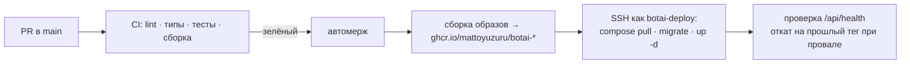

# Деплой на `mnema`

Статус: **план**, 2026-10-27. Выполняется последним этапом, после MVP на фикстурах.

## Что уже есть на сервере (снято read-only 2026-10-27)

| Параметр | Значение |
|---|---|
| Доступ | `ssh mnema` (пользователь `yuzuru`, группа `sudo`) |
| ОС | Ubuntu 24.04.4 LTS, ядро 6.8 |
| CPU | 6 vCPU, Intel Xeon Gold 6240R, **есть AVX512-VNNI** (int8-эмбеддинги ускоряются) |
| Память | 11 ГиБ, занято ≈ 1,5 ГиБ, swap нет |
| Диск | 119 ГБ, свободно 108 ГБ |
| Входящий трафик | **Caddy** на :80/:443, один `/etc/caddy/Caddyfile` с блоками `mnema.app`, `auth.`, `www.`, `admin.` |
| Занятые локальные порты | 13128, 15432, 18080, 18081, 18082 — **это Mnema, не трогать** |
| Docker | работает; `yuzuru` не в группе `docker` |
| DNS | `botai.mnema.app` → IP сервера (проверено) |

## Принципы: не сломать Mnema

1. **Отдельный compose-проект** `botai` в `/srv/botai`, своя docker-сеть. Контейнеры Mnema и
   их сети не трогаем, `docker system prune` и подобное не запускаем.
2. **Один порт наружу из стека:** `127.0.0.1:18090` (API + статика PWA). Postgres BotAI — без
   публикации порта, только во внутренней сети compose. Порты 13128, 15432, 18080–18082 не
   занимаем.
3. **Caddy правится один раз и аккуратно:** копия `Caddyfile` → добавить блок
   `botai.mnema.app { reverse_proxy 127.0.0.1:18090 }` в конец → `caddy validate` → `systemctl
   reload caddy` (reload, не restart: живые соединения Mnema не рвутся). При ошибке валидации —
   откат из копии. CI в Caddy не ходит никогда.
4. **Лимиты ресурсов** в compose: Chromium и воркер ограничены по памяти (`mem_limit`), чтобы
   всплеск BotAI не задушил Mnema. Ориентир: весь стек BotAI ≤ 4 ГиБ.

## CI/CD

| Что | Как |
|---|---|
| Пользователь для CI | `botai-deploy`: без пароля и sudo, в группе `docker`, владелец `/srv/botai`, вход только по ключу CI |
| Секреты GitHub | `DEPLOY_SSH_KEY`, `DEPLOY_HOST`, `DEPLOY_KNOWN_HOSTS`; прикладные секреты (`DEEPSEEK_API_KEY`, `BOTAI_KEK`, пароль БД) — в `/srv/botai/.env` на сервере с правами `0600`, в образы не попадают |
| Откат | Тег образа = SHA коммита; при провале health-check — `up -d` с прошлым тегом |
| Бэкап | Ночной `pg_dump` в `/srv/botai/backups`, хранение 14 дней; **KEK в бэкап не входит** |

## Порядок первого деплоя (вручную, один раз)

1. Создать `botai-deploy`, добавить ключ CI, `/srv/botai` с правами.
2. Положить `/srv/botai/.env` (генерируем `BOTAI_KEK`, пароль БД; ключ DeepSeek — от владельца).
3. Первый `docker compose up -d`, миграции, проверка `curl 127.0.0.1:18090/api/health`.
4. Блок Caddy по п. 3 принципов, проверка `https://botai.mnema.app`.
5. Включить deploy-job в CI.
