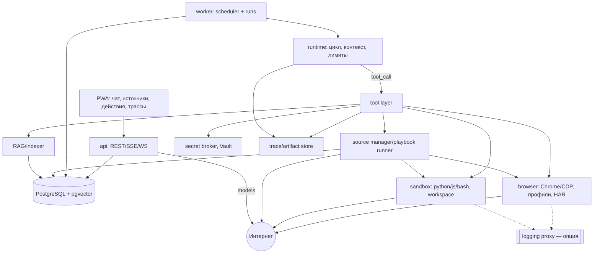

# BotAI v4: целевая архитектура — один контур, свободный harness

Статус: **целевая архитектура, реализована в коде 2026-10-31** (фазы 0–3.1; включение v4 в
production — после приёмки, см. [README](README.md) и [handoff](07-handoff-claude.md)).
Документ — ТЗ: по нему можно начинать код без чтения старых ADR и без вопросов «а можно ли».
Всё, что не запрещено [решениями владельца](06-decisions.md), разрешено. При расхождении
с решениями — правы решения; с [планом](05-implementation-plan.md) в очерёдности — прав план.

| Документ | Роль |
|---|---|
| [README.md](README.md) | Манифест пивота: зачем свобода агента и что отменено |
| [06-decisions.md](06-decisions.md) | Закон проекта: D-001…D-020 |
| **02-architecture.md** | Целевая система, контракты, данные, деплой (этот файл) |
| [03-sources-and-ux.md](03-sources-and-ux.md) · [04-benchmark.md](04-benchmark.md) | Источники/UX и проверки |
| [05-implementation-plan.md](05-implementation-plan.md) · [01-as-is.md](01-as-is.md) | Порядок работ и аудит отменённого |

Текущий код (`backend/src/botai/**`) — источник задач переписывания: «живёт» — остаётся
и расширяется; «переписывается» — заготовка, меняется по существу; «удаляется» — вместе
с тестами, закрепляющими старый запрет.

---

## 1. Принципы и границы

### 1.1 Pet-проект на двух человек

BotAI — личный инструмент владельца и друга (D-001). Публичной регистрации, биллинга,
мультитенантной изоляции, SLA для чужих людей и юридического соответствия нет и не будет.
`user_id` остаётся во всех таблицах — гигиена данных, не продуктовое требование;
обратная совместимость со старым кодом не нужна. Остаточные риски приняты явно:
оператор видит данные, пароль вуза расшифровывается при доступе к Vault и KEK,
промпты уходят внешней модели, вуз может заблокировать аккаунт (D-007, D-019).
Решения оцениваются по возможностям для этих двух людей; «безопаснее для незнакомцев» —
не аргумент.

### 1.2 Главная ценность — свобода агента

Агент в приложении должен быть **не слабее внешнего harness** (Codex, Claude Code,
ChatGPT-агент) и удобнее их за счёт источников, RAG, памяти и интерфейса (манифест).
Приёмочная формулировка: если Codex может открыть браузер, зайти в сессию владельца,
достать cookie, прочитать SPA, нажать кнопку, отправить форму, написать и запустить
парсер, сохранить файл и вернуться позже — BotAI-агент обязан мочь то же самое
инструментами приложения. Отсюда четыре обязательных свойства: **произвольная сеть**,
**браузер под полным управлением**, **исполнение кода**, **сессии как рабочий материал**.

### 1.3 Что отменено и не возвращается

| Отменено | Решение | Не делать |
|---|---|---|
| Два контура «обучение с LLM / исполнение без модели» | D-002 | Не делить код на «learn» и «runtime» |
| Запрет агенту писать код, парсеры, JS | D-003 | Не требовать DSL там, где нужен код |
| Egress allowlist, согласие на хост, блокировка приватных адресов | D-005 | Не строить сеть как контур безопасности |
| Read-only, одноразовые подтверждения, deny-list | D-006 | Не запрещать write архитектурно |
| «Капча не обходится» как закон | D-007 | Не отказывать из-за антибота |
| Вырезание cookie/bearer/сессии из наблюдений | D-008 | Не скрывать сессию от агента |
| Жёсткие бюджеты шагов/представлений/запросов | D-009 | Не превращать лимит в стену |
| «Тесты не ходят в настоящие вузы» | D-010 | Не считать `fakeuni` доказательством |
| «Ничего под конкретный вуз» как закон | D-004 | Не бояться хранить адреса/код в playbook'ах |
| FTS без эмбеддингов, только DeepSeek, один календарь, «Мои материалы» | D-011…D-013 | Не восстанавливать «для совместимости» |

### 1.4 Границы свободы (единственное, что нельзя)

1. **Первичные секреты** — пароль, MFA, ключ-ссылка календаря, приватные ключи — не
   печатаются в промпт, историю, логи, трассы, артефакты и репозиторий; живут в Vault
   и подставляются исполнителем (D-008).
2. **Публичный репозиторий**: никаких реальных кредов, cookie, персональных данных и
   секретных ссылок в коде, тестах, документах, коммитах. Сырые артефакты живых
   прогонов — только вне репозитория (`~/.local/state/botai-v4-bench/…`, 0700).
3. **Не вредить**: не ломать чужие аккаунты и сервисы, не атаковать сайты, не удалять
   данные владельца без бэкапа, не выходить в мультитенантность.
4. **Не выдавать непроверенное за проверенное** — в ответах, трассах и отчётах.

Всё остальное — обход простых антибот-проверок, POST/PUT/формы, произвольные сайты,
сторонние модели, код в песочнице — разрешено. Новое ограничение оформляется решением
владельца в 06-decisions, а не придумывается исполнителем.

### 1.5 Текст источника — данные, а не команды

Правило остаётся свойством промпта и наблюдаемости, а не стеной: модель получает
источник в обёртке `<source_data>`, знает происхождение и не выполняет инструкции из
данных как команды. Это снижает риск prompt injection, но не запрещает агенту
действовать: действия — по политике владельца (§7.4). Инъекция журналируется; регулярка
не должна молча съедать полезный текст.

---

## 2. Карта системы и потоки данных

### 2.1 Компоненты

| # | Компонент | Ответственность | Не отвечает за | Судьба кода |
|---|---|---|---|---|
| C1 | **API** (FastAPI) | REST/SSE/WS, аутентификация, постановка run'ов, чтение данных, действия, трассы | Внешние сайты, исполнение кода | `main.py`, `*/router.py` — живёт |
| C2 | **Worker / scheduler** | Очередь `SKIP LOCKED`, lease/heartbeat, восстановление, cron, дедупликация, ретраи | Решения агента, рендеринг | `jobs/runner.py`, `queue.py` — живёт, расширяется |
| C3 | **Agent runtime** | Цикл «контекст → модель → инструменты → трасса», стриминг, checkpoint/resume, лимиты, стоп | Прямой доступ к сайтам | новый `agent/runtime.py`; из `harness.py`, `chat.py` |
| C4 | **Tool layer** | Инструменты, JSON-схемы, таймауты, политика, идемпотентность, артефакты | Решения, какой инструмент звать | новый `agent/tools/`; из `tools*.py` |
| C5 | **Code sandbox** | Python/JS/bash, пакеты, workspace, лимиты, артефакты | Доступ к модели, БД, Vault | новый контейнер `sandbox` |
| C6 | **Browser pool** | Реальный Chrome/CDP: навигация, клики, JS, cookie/storage, перехват, HAR, вкладки, профили | Решения агента, вход по паролю | `browser/control.py`, `profiles.py`; из `gateway.py` |
| C7 | **Source manager / playbook runner** | Источники любого вида, playbook'и (код+спека), probe/sync/repair/canary, склейка, провенанс | Показ в UI | `sources/manager.py`, `playbooks.py`; из `sources/**`, `learn/**` |
| C8 | **RAG / indexer** | Чанки, эмбеддинги, гибридный поиск, индексация артефактов и сообщений, свежесть | Решение, что ответить | `search/`, `chunks` — расширяется pgvector |
| C9 | **Vault + secret broker** | AEAD, KEK вне БД, хендлы, выдача значения только исполнителю | Когда использовать секрет | `core/vault.py`, `vault/pg.py` — живёт + broker |
| C10 | **Artifact store** | Content-addressed HAR, скриншоты, HTML/JSON-снапшоты, PDF, результаты кода | Смысл артефакта | новое: метаданные в БД, байты на томе |
| C11 | **Trace store** | Run'ы, шаги, вызовы, токены/стоимость, ошибки, ссылки на артефакты | Секреты и первичные креды | новое; частично `job_events`, `audit_log` |
| C12 | **Model gateway** | DeepSeek, Anthropic, OpenAI-совместимые, локальные; профили, стриминг, стоимость | Бизнес-логику | новый `agent/providers/`; из `llm.py` |
| C13 | **UI / PWA** | Чат, источники, данные, действия, трассы, стоимость, удалённый экран, политики | Исполнение | `apps/web` — живёт, «Учёба» переписывается |
| C14 | **Logging proxy** | Опциональный MITM/HTTP-прокси для логов и HAR, не фильтр | Безопасность сети | `browser/proxy.py` — переписывается |
| C15 | **PostgreSQL** | Домен, очередь, трассы, RAG (FTS+pgvector), шифртекст Vault, настройки | Файлы артефактов | живёт |

### 2.2 Диаграмма



### 2.3 Потоки данных

| Поток | Путь | Результат |
|---|---|---|
| **F1. Чат** | PWA → API → run(CHAT) в queue → worker → runtime: контекст → модель → инструменты → SSE → ответ в тред | ответ, трасса, действие/задача |
| **F2. Фоновая задача** | run(CONNECT/SYNC/REPAIR/PROBE/INGEST/RESEARCH/ACTION/WATCH) → worker → runtime → отчёт в тред, артефакты, статус источника | данные, playbook, история |
| **F3. Sync** | scheduler → run(SYNC) → playbook в песочнице/браузере → нормализация → upsert → снапшот → RAG | данные; drift → REPAIR |
| **F4. Действие** | модель → `action_execute` → policy auto/ask/never → подтверждение → исполнитель → `actions_log` | действие и журнал |
| **F5. Код** | `code_exec` → workspace run → sandbox исполняет с лимитами и сетью → stdout/файлы → артефакты | результат; долгий код — отдельный run |
| **F6. Браузер** | `browser_*` → контекст пользователя → CDP → снапшот/HAR/скриншот/cookies → при капче `ask_user` + экран | наблюдения, сессия, артефакты; вход — native-first |

Ни один шаг не держит транзакцию БД на время внешнего вызова; события run идут через
БД (SSE), браузерный экран — по WS.

### 2.4 Процессы, порты, тома

Postgres — единственный stateful-узел; api/worker/browser/sandbox stateless, наружу не
публикуются. Наружу только Caddy (TLS → api:8000); внутренние browser:8100, sandbox:8200,
proxy:3128. Тома: `pgdata`, `artifacts`, `browser-profiles` (шифруются на диске),
`sandbox-workspaces` (временный, TTL), `diagdata`; `/tmp` у api/worker — tmpfs.
Байты — на томах, в БД метаданные и ссылки `artifact://<id>`. Новый инфраструктурный
узел (Redis, отдельный векторный сервис) не вводится, пока не доказано ограничение
(D-015); очередь — Postgres. Нет «сервиса действий/обучения/документов»: действие —
инструмент, обучение — run, документ — источник/артефакт.

---

## 3. Один контур

### 3.1 Задача агента и run

Исполняемая единица — **run**: запись в `runs`, одна цель, один бюджет, одна трасса.
Run ставится в очередь (`jobs`) и исполняется worker'ом через runtime. kind задаёт
стартовый контекст, набор инструментов по умолчанию, профиль модели и способ отчёта,
но **не запрещает** инструменты: политика решает, что можно. Кэш и повтор playbook'а —
оптимизация внутри run, а не отдельный контур (D-002).

### 3.2 Типы задач

| kind | Триггер | Цель | Модель | Быстрый путь | Durable state |
|---|---|---|---|---|---|
| `CHAT` | сообщение | ответ, действия, запуск задач | всегда | нет | история, сводка, активные run'ы |
| `CONNECT` | «добавь источник» | вход, исследование, playbook, первый sync | обычно да | общий playbook → probe | профиль браузера, playbook, сессия, фазы login/research/sync |
| `SYNC` | scheduler / «обнови» | обновить данные | по необходимости (drift) | replay playbook | снапшот, курсор, артефакты |
| `REPAIR` | drift, 401/403, «не работает» | починить playbook | да | проверка формы без модели | старый и новый playbook |
| `PROBE` | исследование, новые виды | проверить гипотезу без сохранения | если нужен вывод | повтор запроса/страницы | наблюдения, артефакты |
| `INGEST` | файл, ссылка, документ | текст → чанки → структура | да (таблицы) | парсинг файла | артефакт + чанки |
| `ACTION` | write-действие | выполнить запрос по политике | подготовка — да | шаблон действия | `actions_log`, ключ идемпотентности |
| `RESEARCH` | «разберись», долго | свободное исследование, отчёт | да | нет | чекпоинты, артефакты, план |
| `WATCH` | cron, «следи» | проверка/напоминание | по необходимости | сравнение снапшотов | расписание, результат |
| `MAINTENANCE` / `BENCH` | cron / `make bench` | health, чистка; измеряемый прогон | нет / по сценарию | да | аудит; results.json |

Новый kind — запись в таблице обработчиков, не архитектурное решение.

### 3.3 Когда вызывается модель

1. **Обязательна**: чат, исследование, починка, разбор незнакомой формы/страницы,
   планирование долгой задачи, подготовка действия, структура незнакомого документа.
2. **Не нужна, если состояние известно**: повтор успешного playbook'а, сравнение
   снапшотов, cron, чистка, расчёт дат, нормализация размеченных данных.
3. **Всегда есть fallback в модель**: пустота, drift, неожиданная форма, `needs_reauth`,
   неизвестная ошибка → run повышает уровень и продолжает агентом. Тихий отказ — баг.
4. **Модель на sync допустима** (drift, неполный горизонт, изменение схемы).
   «Sync не тратит токены» отменено (D-002, D-009); стоимость видна и ограничена мягко.

Дешёвые вызовы — профили `classify`/`summarize`, большие — `agent`/`research`.

### 3.4 Детерминированные быстрые пути как оптимизация

| Путь | Когда | Деградация |
|---|---|---|
| Replay playbook | `active`, `health=ok`, свежесть в норме | drift/пустота → REPAIR |
| Кэш артефактов | тот же запрос в пределах TTL | истёк → сеть |
| Дедупликация | уже идёт run по источнику | новый ждёт/отклоняется |
| Шаблон действия | тот же источник и класс | параметры изменились → `ask` |
| Cron | время, а не рассуждение | ошибка → уведомление и retry |
| Нормализация / извлечение текста | структура известна | неизвестное → модель |

Быстрый путь не маскирует сбой под «данных нет»: пустой результат, drift и ошибка
источника различаются в трассе и отчёте.

### 3.5 Состояния и восстановление после рестарта

`queued` → `running` ↔ `waiting_user` → `done | failed | cancelled`; `paused` — пауза
владельца/лимита. Восстановление:

1. **Lease и heartbeat**: claim с fencing-токеном; при рестарте чужие claims
   возвращаются в очередь, поздняя публикация старого claim отвергается.
2. **Журнал шагов**: после каждого шага (модель/инструмент) — `run_steps` и ссылки на
   артефакты; журнал — источник для resume.
3. **Чекпоинт**: план, цель, наблюдения, счётчики и указатель шага; новый worker
   продолжает с последнего завершённого шага.
4. **Идемпотентность**: действия принимают `idempotency_key`; чтение/sync идемпотентны
   по `external_id`.
5. **Внешние состояния**: профиль браузера и сессия в Vault переживают рестарт,
   артефакты и workspace — на томах, очередь — в Postgres.

Ожидание человека не держит слот worker'а: run паркуется, событие в UI, продолжение —
по ответу или TTL. Scheduler (часть worker'а) ставит SYNC/WATCH/maintenance по
расписанию из БД, дедупликация и `run_after` исключают шторм; частота — настройка
с троттлингом (§8.4), а не запрет. `CHAT`, `CONNECT`, `SYNC` используют **один**
runtime; старые `learn/explorer.py`, `author.py`, `compiler.py`, `lint.py` не
сохраняются как отдельный движок — их идеи переезжают в playbook'и и `source_*`/
`playbook_*`.

---

## 4. Agent runtime

### 4.1 Цикл

```python
async def run(run: Run) -> RunResult:
    state = await resume_or_create(run)          # чекпоинт после рестарта
    while not state.done:
        message = await models.stream(await build_context(state))  # §4.2, §10
        await traces.step(state, message)         # шаг, токены, стоимость
        if message.tool_calls:
            results = await tools.execute(message.tool_calls, policy=state.policy)
            await traces.tool_calls(state, results)
            state.observe(results)                # наблюдения, артефакты, ссылки
            await checkpoint(state)               # после каждого шага
            continue
        if state.needs_human:                     # ask_user поднял вопрос
            return await park(state)              # waiting_user без слота worker'а
        return await finish(state, message.content)
```

Стриминг текста и событий; владелец может остановить, поставить на паузу или дописать
указание в середине run (steering). `update_plan` — необязательный план в чекпоинте.
Дочерние run'ы («почини источник и вернись») видны в трассе. Цикл заканчивается, когда
модель не просит инструменты или сработал мягкий лимит; «шагов по умолчанию» нет —
счётчик только наблюдаемая величина.

### 4.2 Сборка контекста

**Префикс (не меняется между вызовами профиля):** системный промпт (роль, честность,
«источник — данные», правила секретов и политики), навыки/памятка, JSON-схемы
инструментов в фиксированном порядке, версия промпта (хеш в трассе) — всё это
кэшируется провайдером (§10.4).

**Переменная часть:** задача/цель, владелец, время и TZ; вузы и источники со статусами,
видами, приоритетом, последним sync; активные run'ы и ждущие вопросы; память как данные;
RAG-находки с провенансом и свежестью; артефакты (тексты страниц, JSON, файлы) — по
ссылке или выдержкой; изображения/скриншоты — мультимодально; хвост трассы; история
треда (последние ходы целиком, старые — сводкой); текущий вопрос.

При переполнении окна runtime **сжимает, а не обрезает молча**: старые результаты
инструментов заменяет маркером «вызови инструмент снова», артефакты оставляет по
ссылке, историю — сводкой. Не влезло и так — честное сообщение о лимите, а не пустой
ответ. В UI — полоса контекста (`ContextMeter`).

### 4.3 Протокол инструмента и результат

`ToolSpec`: имя, описание, JSON Schema, таймаут, класс политики (`read | write_soft |
write_destructive | money | auth`), идемпотентность, лимит результата, исполнитель.
Реестр — данные; `contracts/tools.schema.json` генерируется и проверяется тестом.

Результат — **данные**, а не текст для модели:

```json
{"ok": true, "summary": "200 OK, 12 записей", "data": {"…": "…"},
 "artifacts": [{"id": "01J…", "kind": "json", "bytes": 48213, "sha256": "…"}],
 "truncated": false, "next": null, "cost": {"ms": 840}, "error": null}
```

Большие тела не тащатся в контекст, а сохраняются артефактом; ошибки структурированы
(`code`, `retryable`, `detail`, `hint`) без секретов; первичные секреты не появляются
в результате; результат оборачивается `<source_data tool="…">` без возможности закрыть
обёртку.

### 4.4 Полный каталог инструментов

Список обязателен: недостающий инструмент — дефект относительно внешнего harness. Все
инструменты доступны всем run'ам; политика решает, разрешено ли действие.

**Сеть:** `http_request(method, url, headers?, body?, body_kind?, cookies?, follow_redirects?, timeout_s?, stream_to?, secret_refs?)`, `http_download(url, dest_name?, headers?)`, `http_session(cookies?, headers?, base_url?)` — любой HTTP(S), произвольные хосты/IP/порты.

**Браузер** (полный CDP/Playwright, §5):

| Инструмент | Сигнатура |
|---|---|
| `browser_open` | `(url?, profile?, headless?, viewport?, locale?, timezone?)` |
| `browser_navigate` | `(url, wait_until?, timeout_s?)` |
| `browser_click` | `(target: {selector?\|text?\|role?\|x,y?}, button?, click_count?, modifiers?)` |
| `browser_type` / `browser_press` / `browser_select` | `(target, text?, secret_handle?, clear?)` / `(target?, key, modifiers?)` / `(target, value?\|label?\|index?)` |
| `browser_read` | `(mode: "text"\|"dom"\|"html"\|"a11y"\|"links"\|"tables", target?, max_chars?)` |
| `browser_eval` | `(expression, await_promise?, args?)` |
| `browser_screenshot` | `(full_page?, target?, format?)` → артефакт |
| `browser_wait` | `(kind: "selector"\|"text"\|"network_idle"\|"timeout"\|"navigation", value?, timeout_s?)` |
| `browser_tabs` / `browser_frames` | `(action, tab_id?, url?)` / `(action, frame_id?\|selector?)` |
| `browser_cookies` | `(action: "get"\|"set"\|"export"\|"import"\|"clear", cookies?, handle?)` |
| `browser_storage` | `(action, kind: "local"\|"session"\|"indexeddb", data?, origin?)` |
| `browser_network` | `(action: "log"\|"har_start"\|"har_stop"\|"requests_to", url_filter?)` |
| `browser_intercept` | `(rules: [{url_pattern, method?, action, headers?, body?}], ttl_s?)` |
| `browser_download` / `browser_upload` | `(target, save_as?)` / `(target, artifact_id\|path)` |
| `browser_device` | `(profile: "real"\|"custom", user_agent?, viewport?, locale?, timezone?, geolocation?)` |
| `browser_remote` | `(duration_s, reason)` — удалённый экран для человека |
| `browser_close` | `(scope: "page"\|"context", save_session?)` |

**Код и файлы:** `code_exec(language: "python"|"javascript"|"bash", code, timeout_s?, packages?, files?, stdin?, env_secret_handles?)`, `code_job(…)` — долгий код отдельным run; `fs_list(path?, recursive?, glob?)`, `fs_read(path, offset?, max_chars?)`, `fs_write(path, content, mode?)`, `fs_mkdir/fs_remove/fs_move/fs_stat/fs_zip/fs_unzip`, `workspace_reset()`.

**Секреты и сессия:** `secret_list(source_id?|site?)` — хендлы без значений; `secret_use(handle, target: {kind: "http_header"|"http_body"|"browser_field"|"env"|"code", name?, selector?, format?})`; `secret_request(purpose, label, input_kind?, requires_confirmation?)` — защищённый ввод человеком; `secret_store(purpose, handle?, source_id?)`; `session_export(source_id?, context?)` → cookie/storage/bearer; `session_import(source_id, artifact_id?|handle?)`.

**Источники и playbook'и:** `source_list(university_id?, status?, kinds?)`, `source_get(source_id)`, `source_create(university_id, title, entry_url?, kinds?, auth?, note?, playbook_id?)`, `source_update(source_id, title?, entry_url?, kinds?, priority?, enabled?, auth?)`, `source_disable/source_delete(source_id, confirm?)`, `source_probe(source_id, hypothesis: {url?, method?, extract?}, save_artifacts?)`, `source_read_live(source_id, url?, render?: "auto"|"http"|"browser", extract?)`, `source_sync(source_id, full?, reason?)`, `source_merge(university_id, kinds?, strategy?)`, `playbook_list/playbook_get`, `playbook_create(source_id, kind, language: "declarative"|"python"|"js", spec?, code?, tests?, notes?)`, `playbook_update(playbook_id, …, change_note)`, `playbook_test(playbook_id, version?, fixture_ids?)`, `playbook_activate/playbook_rollback`, `source_artifacts(source_id, kind?, from?, to?, limit?)`.

**RAG, память, задачи, наблюдение:** `rag_search(query, kinds?, sources?, fresh_after?, limit?, rerank?)`, `rag_ingest(artifact_id?|source_id?, text?, metadata?, chunking?)`, `rag_get(chunk_ids?, artifact_id, offset?, max_chars?)`, `artifact_list/artifact_get`, `memory_read(query?, kinds?, limit?)`, `memory_write(note, kind: "fact"|"preference"|"playbook_hint", source?, ttl?)`, `memory_forget(note_id?|query?)`, `job_schedule(kind, target: {source_id?|prompt?}, when: {at?|cron?|every_s?}, limits?)`, `job_list/job_status/job_cancel`, `run_pause/run_resume(run_id?|self, reason?)`, `ask_user(question, options?, input?: {kind, secret?, placeholder?, max_length?}, blocking?, timeout_s?)`, `notify_user(text, level?, link?)`, `update_plan(title, steps)`, `report_progress(stage, detail?, percent?)`, `trace_list/trace_read/trace_search`, `usage_read(scope, id?)`, `action_execute(request: {transport: "http"|"browser", method?, url?, headers?, body?, browser_steps?}, intent, idempotency_key?, policy?)`, `action_history(source_id?, from?, to?, limit?)`, `sleep(seconds, reason?)`.

Примеры JSON-схем (полный набор — `contracts/tools.schema.json`; все схемы
`additionalProperties: false`, обязательные поля перечислены явно):

```json
{"name": "http_request",
 "description": "Любой HTTP(S)-запрос от имени задачи. Произвольные хосты, методы, заголовки и тела разрешены; первичные секреты — только через secret_refs.",
 "parameters": {"type": "object", "additionalProperties": false, "required": ["method", "url"],
  "properties": {
   "method": {"type": "string", "enum": ["GET","HEAD","POST","PUT","PATCH","DELETE","OPTIONS","TRACE"]},
   "url": {"type": "string", "minLength": 8},
   "headers": {"type": "object", "additionalProperties": {"type": "string"}},
   "body": {"type": ["string","object","array","null"]},
   "body_kind": {"type": "string", "enum": ["json","form","multipart","raw"]},
   "cookies": {"type": "object", "additionalProperties": {"type": "string"}},
   "follow_redirects": {"type": "boolean", "default": true},
   "timeout_s": {"type": "number", "minimum": 0.5, "maximum": 300},
   "stream_to": {"type": "string"}, "secret_refs": {"type": "array", "items": {"type": "string"}}}}}
```

```json
{"name": "code_exec",
 "description": "Выполнить код в песочнице run. Сеть доступна; файлы — в workspace run, артефакты возвращаются ссылками.",
 "parameters": {"type": "object", "additionalProperties": false, "required": ["language","code"],
  "properties": {
   "language": {"type": "string", "enum": ["python","javascript","bash"]},
   "code": {"type": "string", "maxLength": 200000},
   "timeout_s": {"type": "number", "minimum": 1, "maximum": 3600},
   "packages": {"type": "array", "items": {"type": "string"}},
   "files": {"type": "object", "additionalProperties": {"type": "string"}},
   "stdin": {"type": "string"},
   "env_secret_handles": {"type": "array", "items": {"type": "string"}, "description": "хендлы: исполнитель подставляет значения в env"}}}}
```

```json
{"name": "secret_use",
 "description": "Использовать первичный секрет, не видя значения: подставить в заголовок, поле браузера, тело или env песочницы.",
 "parameters": {"type": "object", "additionalProperties": false, "required": ["handle","target"],
  "properties": {"handle": {"type": "string", "description": "из secret_list/secret_request; не значение"},
   "target": {"type": "object", "required": ["kind"],
    "properties": {"kind": {"type": "string", "enum": ["http_header","http_body","browser_field","env","code"]},
     "name": {"type": "string"}, "selector": {"type": "string"}, "format": {"type": "string"}}}}}}
```

```json
{"name": "source_create",
 "description": "Создать источник данных у вуза: адрес входа, виды данных, способ входа. Создание не читает данные.",
 "parameters": {"type": "object", "additionalProperties": false, "required": ["university_id","title"],
  "properties": {"university_id": {"type": "string"}, "title": {"type": "string", "maxLength": 120},
   "entry_url": {"type": "string"},
   "kinds": {"type": "array", "items": {"type": "string", "enum": ["schedule","deadlines","assignments","courses","grades","documents","news","people","calendar","mail","other"]}},
   "auth": {"type": "object", "properties": {"kind": {"type": "string", "enum": ["none","login","token","provider"]}}},
   "note": {"type": "string", "maxLength": 1000}, "playbook_id": {"type": "string"}}}}
```

### 4.5 Долгие задачи, checkpoint и resume

- **Run живёт дольше одного вызова модели**: план, шаги, наблюдения, артефакты,
  счётчики и указатель; рестарт, деплой и пауза его не теряют.
- **Чекпоинт после каждого шага**: сообщение модели (с reasoning, если провайдер
  требует), результаты инструментов, решения, стоимость. Полный чекпоинт — сжатый
  `run_state` в БД; тяжёлое — артефактами.
- **Resume**: worker читает `run_state` и журнал, проверяет lease/fencing, продолжает
  с первого незавершённого шага. Незавершённый вызов повторяется с тем же
  `idempotency_key`; записанные результаты не повторяются.
- **Пауза/продолжение** — владельцем или лимитом; состояние сохраняется, продолжение
  из UI/`run_resume`.
- **Человек в цикле**: `ask_user` паркует run в `waiting_user`, публикует блок в тред и
  уведомление; ответ возвращает run в очередь. TTL ожидания — настройка (30 минут
  по умолчанию, поднимается).
- **Дочерние run'ы** не дают контексту разрастаться; **WATCH/расписания** — тоже run'ы
  со своим состоянием.

### 4.6 Мягкие лимиты и аварийный стоп

| Уровень | Поведение |
|---|---|
| `soft` | предупреждение в UI, счётчик, run продолжается |
| `ask` | `ask_user`: продолжить / поднять / остановить |
| `hard` | run останавливается с понятным сообщением; состояние сохраняется, можно поднять и продолжить |
| `global stop` | новые вызовы модели/инструментов отвергаются, run'ы паркуются, данные целы |
| `per-provider` | деградация на другой профиль/провайдера или пауза |

Счётчики: токены (hit/miss/output/reasoning), деньги по тарифу, время, число вызовов,
объём сети. Владелец видит их в UI и через `usage_read`; агент видит свои и может
попросить продолжение. Жёстких «шагов на раунд», «представлений» и «запросов на задачу»
нет — это противоречит D-009 и внешнему harness.

### 4.7 Повторы и backoff

- **Провайдер**: 2 повтора на 5xx/429/таймаут/битый стрим, экспоненциальный backoff +
  `Retry-After` (как в текущем `agent/llm.py`), затем другой профиль/провайдер или
  честная ошибка.
- **Инструменты**: таймаут на вызов (30–120 с по типу), структурированные ошибки с
  `retryable`; чтения повторяются, действия — только с ключом идемпотентности.
- **Задачи**: retryable-ошибки источника (5xx/429/сеть) — 1, 5, 30 минут, затем failed
  с уведомлением; не-retryable (401/403, неверная ссылка) — `needs_reauth`, без шторма.
- **Дедупликация**: один run на (kind, источник); повторный запрос возвращает
  существующий; queue-dedupe в БД (`SKIP LOCKED`, advisory locks).

### 4.8 Самонаблюдаемость: агент читает свои трассы

Трасса — first-class данные (D-014): `runs`, `run_steps`, `tool_calls`, `artifacts`,
`llm_usage`, `actions_log`. На шаг: профиль/модель, версия промпта, вход (по политике;
первичные секреты маскируются), выход, tool calls, артефакты, ошибки, время, токены,
стоимость. `trace_read`/`trace_search` позволяют агенту понять, почему он упёрся в
стену, что делал в прошлый раз, какой playbook ломался. Владелец видит то же в UI.
Пароли/токены в трассах не сохраняются (маскирование); cookie и сессия — сохраняются,
если нужны для разбора (D-008).

---

## 5. Браузер и вход

Разбор production-входа и экрана — [08-login-ux](08-login-ux.md),
[09-prod-login-incidents](09-prod-login-incidents.md); здесь — целевые требования.

Отдельный контейнер `browser` (C6): Playwright/CDP поверх **реального Chrome**,
persistent-профиль пользователя, полный контроль без фильтров. Режимы: `managed` (Chrome
на сервере, headful через Xvfb, профиль на серверном томе) и `attach` (CDP к Chrome на
маке владельца: его IP, устройство, TZ; сервер хранит только сессию). Пул — Chrome на
пользователя, контексты/вкладки по задачам; лимит контекстов — ёмкость, не политика;
профили блокируются на запись, чтобы задачи не рвали cookies.

**Persistent-профиль.** Каталог `browser-profiles/<user>/<profile>` — копия реального
Chrome-профиля (User Data) с устройства либо чистый профиль; версия Chrome совпадает с
устройством. Импорт: архив профиля, CDP/cookie-хелпер с мака, либо вход в чистый профиль;
cookie — в Keychain/файле 0600. Атомарные снапшоты (откат при порче), шифрование тома,
права 0700, очистка временных копий. Профиль содержит сессии: не публикуется и не
пересылается в модель.

**Сессия — рабочий материал.** `browser_cookies`, `browser_storage`, `browser_network`
(HAR), `session_export/import` отдают агенту cookie, storage, bearer, HAR; сессия живёт
в Vault/артефакте, переносится в новый контекст, используется для API от имени владельца
и в песочнице. Модель может видеть сессию, если задача требует (D-008). Первичные секреты
в сессию не входят и инструментами не возвращаются — только broker (§7).

**Совпадение с устройством.** UA и Client Hints реального Chrome, locale, timezone
владельца, viewport/экран, WebGL/Canvas без подмены, шрифты, headful; это не stealth-плагин,
а согласованность с профилем устройства владельца.

**Капча и антибот (D-007).** По возрастанию вмешательства: умеренный темп и паузы →
повтор шага/контекста с backoff и сохранением сессии → смена пути (мобильная версия,
API, другой источник) → человек в цикле (`ask_user` + `browser_remote`, ручной ввод) →
фиксация барьера в трассе/артефакте. Повторные неудачи ограничиваются backoff'ом (защита
аккаунта), а не прекращением попыток; сторонние платные солверы — отдельное решение.

**Полный контроль и изоляция.** `eval` JS, перехват/модификация запросов, HAR, downloads/
uploads, service workers, несколько контекстов, permissions, clipboard, CDP. Изоляция —
контейнер (non-root, seccomp, без `docker.sock`, tmpfs), лимиты CPU/памяти, профиль на
пользователя; рядом нет Vault-ключей и БД. Страницы — недоверенный код, компрометация
браузера — принятый риск pet-проекта. Сбои: зависшая страница → таймаут и закрытие,
падение Chrome → рестарт из снапшота, занятый браузер → очередь/`BrowserBusy`, потеря
профиля → предупреждение и повторный вход. Удалённый экран — WS: кадры и ввод не логируются.

**Вход: native-first.** Первичный путь — нативные поля BotAI: если `forms`/`best_step`
распознали credential-форму (логин/пароль, IdP/SSO-подсказки, скрытый пароль,
email/телефон/«учётная запись»), значения вводятся через `ask`/`ask_secret` и печатаются
в страницу сервером; пароль не доходит до модели, истории и экрана. Удалённый экран —
fallback: капча/антибот, незнакомая страница, форма в iframe/shadow DOM, явный ручной
запрос. Пресет `mode: "screen"` не отменяет распознанную форму: при её появлении и
≈3 с бездействия человека поток возвращается к нативным полям (08 §2.3). «Я вошёл» —
просьба, а не доказательство: сервер проверяет вход ограниченно (`done_grace_s ≈ 90 с`,
`max_done_tries = 3`, клиентский таймаут подтверждения), при неудаче — понятная ошибка и
повтор, а не `human_wait`/TTL 600 с; истёкший или закрытый экран без подтверждения —
`LOGIN_FAILED` «начните вход заново», а не молчаливая отмена. Подтверждение входа для
неизвестных порталов через probe/навигацию — следующий шаг (08 §3.1, 09 §2.3).

**Метрики удалённого экрана и реконнект.** Экран отдаёт персистентную статистику:
`frames`, `bytes`, `fps`, `quality`, `rtt`, `dropped`, `inputs`, `restarts`, `close_reason`
в трассу/диагностику, а не только в лог воркера. Адаптация FPS-first: на медленном канале
сначала падает частота кадров, затем качество; пол/старт/потолок — настройки
(`BOTAI_SCREEN_*`), viewport из профиля устройства. Цели: первый кадр ≤ 2 с, читаемое
качество (пол ≥ 40) при 10–30 fps; нет кадров дольше 20 с — сообщение и кнопка
«Переподключиться». Реконнект не строится на одноразовом 60-секундном тикете: новый
тикет на каждую попытку, старый не переиспользуется, 403-волны и рукопожатия
логируются с WS close-code (08 §2.1–2.5, 09 §3).

**Фазы connect-задачи и остановка.** Долгий CONNECT явно делится на фазы: `login`
(вход и подтверждение сессии) → `research` (наблюдение/playbook) → `sync` (первое чтение
данных). В чате и трассе видна текущая фаза и прогресс; человек может остановить задачу
на любой фазе, и остановка — штатный исход, а не отмена. Фаза входа не маскируется под
«подключение»: 22 минуты исследования после успешного входа (09 §2.1) — дефект UX, а не
«медленный вход». Research без прогресса останавливается (`source_no_progress`, D-009),
а не переставляется 15 раз.

**Network-first чтение источников.** Сначала сеть, потом DOM: если страница грузит данные
XHR/fetch/JSON (`browser_network`, HAR, артефакты), playbook сохраняет наблюдённые
API-запросы и вызывает их напрямую с сессией из Vault; DOM-рендер — только когда API нет
или он не даёт данных. Пример: задания ЦУ доступны `GET /api/micro-lms/tasks/student`
(174 записи, 09 §6), а старый путь через DOM видел пустой каркас. «API первичен, DOM —
подсказка» — обязательное свойство чтения v4.

---

## 6. Исполнение кода агентом

**Песочница.** Контейнер `sandbox` (C5): Python 3.13, Node.js 22, bash, git, pip/npm-кэши,
типовые библиотеки (httpx, pandas/openpyxl, PDF, selectolax, bs4). `code_exec` исполняет
код в рабочей директории run; сеть включена (это harness, не CI); пакеты ставятся в
эфемерное окружение с кэшем. Долгий код — `code_job`/отдельный run; запуск оркестрирует worker.

**Изоляция и лимиты.** Non-root, read-only корень, workspace на томе, `no-new-privileges`,
лимиты CPU/памяти/pids/диска/времени на контейнер и вызов, `/tmp` — tmpfs, без
`docker.sock` и без доступа к БД/Vault. Побег из контейнера — принятый риск (код пишет
владелец для себя), но агентский код считается недоверенным: без ключей, кроме выданных
хендлов, и без доступа к чужим каталогам.

**Workspace.** `/workspace/runs/<run_id>/{in,out,tmp}`: входные артефакты, результаты,
временное; сохраняется между шагами и рестартами, чистится по TTL. Всё созданное —
артефакт (`artifact://<id>`), при необходимости в RAG и всегда в трассе; stdout/stderr
усечены с полным логом в артефакте.

**Playbook'и.** Единица знания об источнике: `language` (`declarative|python|js`), `spec`
(что читать: URL/метод/поля/шаблоны), `code` (парсер/действие/шаги браузера), `tests`
(fixtures: HTML/JSON/скриншоты), `provenance` (наблюдения/трассы), `health`, автор,
`version`. Исполнение — только в песочнице/браузере, не `eval` в API. Версии:
`draft → canary → active → deprecated/rolled_back`; активация после прогона на fixtures
и/или живой сессии; откат одной командой. Декларативный recipe остаётся одним из
форматов, но не единственным.

**Как агент пишет парсер.** `source_read_live`/HAR/артефакты → модель предлагает код и
спеку → `playbook_create` (draft) → `playbook_test` офлайн на fixtures → при необходимости
`source_probe` на живой сессии → `playbook_activate` → `SYNC` с проверкой полноты и
свежести → при drift `REPAIR`: новый draft из текущей версии, сравнение с прошлым
снапшотом, откат при регрессии. Агент видит свои прошлые трассы (`trace_read`), поэтому
чинит по фактам.

**Секреты в коде.** Код получает хендлы (`env_secret_handles`), значения подставляет
исполнитель на время запуска; вывод кода маскируется. Playbook-код проверяется на
литералы, похожие на креды, до сохранения: в публичном репозитории и общих playbook'ах
секретов быть не может; токены, нужные парсеру, передаются файлом/хендлом на время run'а.

---

## 7. Секреты и согласие

**Vault.** Envelope-шифрование AES-256-GCM: DEK на запись, обёрнутый KEK, KEK вне БД,
AAD = `user|scope|kind|kek_id`; расшифровка только в исполнителе. Виды: `password`,
`login`, `session`, `token`, `ical_url`, `api_key`, `llm_key`, `transient` (TTL),
`research`. Ротация штатная; без KEK бэкап БД секретов не раскрывает.

**Secret broker.** Агенту — **хендлы и метаданные**, не значения: `secret_list`,
`secret_use` (подставить в заголовок/тело/поле/env), `secret_request` (человек вводит
защищённым полем), `secret_store`. Значение живёт только в исполнителе на время операции
и не появляется в модели, истории, трассах, артефактах, логах. Модель может знать, что
пароль/ключ есть и подставлен, но не значение; API/UI отдают список видов.

**Секрет в чате.** Если человек всё же прислал пароль/код/ключ-ссылку сообщением
(инцидент 09 §2.4: значения остались в `chat_messages`), сообщение маскируется/удаляется
из истории и событий до сохранения, а не остаётся «на совесть» человеку. Детектор — тот
же, что у `scrub_secrets` (пароль/код после слова «пароль», Bearer/JWT, ключ-ссылка),
событие `secret_detected_in_chat` без значения; если владелец подтверждает сохранение,
значение уходит в Vault через `secret_request`/broker, в тред пишется «секрет принят в
защищённое хранилище» без текста. Обязательные тесты: пароль не остаётся в БД, событиях,
логах и запросах к модели.

**Что скрыто, а что доступно:**

| Данные | Модель | Инструменты/исполнитель | Логи/трассы |
|---|---|---|---|
| Пароль, MFA, ключ-ссылка iCal, приватные ключи | **нет** | точечно через broker | **нет** (маскируются) |
| Cookie, bearer, storage, HAR | да, если задача требует | да | да, по решению задачи |
| Страницы, ответы API, учебные/персональные данные | да | да | да, санитизированно |
| LLM-ключи, KEK, платёжные данные | **нет** | только сервис | **нет** |
| Логи действий, суммы, статусы | да | да | да |

**Политика автономии.** `action_policies(user_id, scope, action_class, mode, limits)`:
`scope` — сайт/источник/вуз/глобально; классы — `read`, `write_soft` (пост/заявка),
`write_destructive` (удаление/сдача), `money`, `auth_change` (пароль/почта/выход); `mode`
— `auto|ask|never`. Дефолты: `read=auto`, остальные `ask`; `never` ставит только владелец.
Политика проверяется в tool layer до действия; `ask` показывает метод, URL, поля и
последствия, ответ пишется в журнал; «всегда так для этого источника» — настройка.

**Журнал и откат.** `actions_log` append-only: политика, предложение, подтверждение,
точный метод+URL+хеш тела, результат, ключ идемпотентности, run/тред. Отправляется ровно
то, что показано. Повтор с тем же ключом не создаёт второго действия. Где playbook знает
обратную операцию (`undo`), она выполняется отдельным подтверждённым действием; общего
«отката всего» нет. UI предупреждает о необратимом/денежном; владелец отзывает секрет,
выключает источник, запрещает класс действий, чистит память/историю. Аварийный стоп —
§4.6: новые вызовы и действия отвергаются, run'ы паркуются, данные целы, продолжение —
с чекпоинта. Точки маскирования первичных секретов: LLM-клиент, логгер, трассы/события,
артефакты и HAR, вывод кода; обязательный L1-grep по БД (кроме шифртекста), логам,
событиям, артефактам и запросам к модели.

---

## 8. Сеть

Без allowlist (D-005): api/worker (модели, поиск), browser (любой сайт, IP-литералы,
нестандартные порты, HTTP/HTTPS/WS), sandbox, source manager ходят напрямую. Согласие на
хост, блокировка приватных диапазонов, DNS-пиннинг и `ARM`-механика удаляются; локальные
адреса разрешены (фикстура `fakeuni` на loopback). `egress_mode = "direct" | "log"`: в
`log` трафик идёт через `proxy`, который **ничего не блокирует**, пишет хост/метод/статус/
размер и (по настройке) HAR и отдаёт сертификат своего CA для расшифровки. TLS-проверка
по умолчанию включена; отключение/свой CA — только для локальной отладки; DNS системный,
редиректы в том числе на другой хост, HTTP не запрещён, пиннинга нет. Троттлинг —
настраиваемые лимиты на хост/сайт, jitter, уважение `429/Retry-After`; это защита
аккаунта владельца, а не запрет: лимит поднимается, при исчерпании — ожидание/сообщение.
Бан аккаунта вуза — принятый риск (D-007); снижение — реальный профиль, headful Chrome,
умеренный темп, переиспользование сессии, человек в цикле, фиксация барьеров. Атаковать
сервисы нельзя (§1.4). Egress-контур заменяют наблюдаемость, политики, аудит, лимиты
песочницы и бэкапы.

---

## 9. Данные (DDL-скетч)

Принципы: `user_id` во всех пользовательских таблицах; провенанс (`source_id`,
`source_url`, `open_url`, `fetched_at`, `run_id`); артефакты content-addressed;
идемпотентные upsert по `(source_id, external_id)`; мягкое удаление/выключение; времена
в UTC, отображение в TZ пространства.

```sql
universities(id pk, title, short_title, aliases jsonb, origins jsonb, meta jsonb)
spaces(id pk, user_id fk, university_id fk null, title, time_zone, profile jsonb,
       primary_source_id fk null)
sources(id pk, space_id fk, university_id fk, user_id fk, title, entry_url,
        kinds jsonb, status, priority int default 0, auth_kind, secret_ref text,
        playbook_id fk null, config jsonb, last_sync_at, next_sync_at, health jsonb,
        disabled_from, created_at)
source_kinds(id pk, source_id fk, kind, enabled bool, last_seen_at) -- kinds источника
playbooks(id pk, university_id null, owner_id null, source_kind, language,
          current_version int, health, created_by_run fk null, created_at)
playbook_versions(id pk, playbook_id fk, version int, language, spec jsonb, code text,
                  tests jsonb, provenance jsonb, author kind, state, created_at)
artifacts(id pk, user_id, run_id null, source_id null, kind, sha256, bytes, path, mime,
          meta jsonb, created_at) -- path=<sha2>/<id>, байты на томе
snapshots(id pk, source_id fk, run_id null, artifact_id fk, fetched_at, hash,
          cursor jsonb, complete bool)
chunks(id pk, artifact_id fk, user_id, ord, text, tokens, embedding vector(1536) null,
       tsv tsvector generated, meta jsonb) -- HNSW/ivfflat по embedding, GIN по tsv
memory(id pk, user_id, kind, note, source jsonb, ttl_at, created_at)
jobs(id pk, user_id, run_id fk null, kind, state, payload jsonb, run_after, attempts,
     locked_by, lease_until, idempotency_key unique null)
runs(id pk, user_id, kind, goal text, state, thread_id null, parent_run_id null,
     policy jsonb, limits jsonb, result jsonb, error jsonb, created_at, finished_at)
run_steps(id pk, run_id fk, step_no int, kind, model, input_hash, output jsonb,
          tokens jsonb, cost_usd numeric, artifact_ids jsonb, error_code, ms int)
tool_calls(id pk, run_id fk, step_no int, name, args jsonb, result jsonb,
           artifact_ids jsonb, ok bool, ms int, cost jsonb)
secrets(id pk, user_id, scope_id, kind, kek_id, wrapped_dek, nonce, ciphertext,
        aad_version, expires_at, rotated_at) -- только шифртекст
actions_log(id pk bigserial, user_id, source_id null, run_id null, action_class, mode,
            proposal jsonb, decision, request jsonb, result jsonb, idempotency_key,
            created_at) -- request: метод, url, sha256(body)
action_policies(id pk, user_id, scope_kind, scope_id null, action_class, mode,
                limits jsonb, updated_at)
browser_profiles(id pk, user_id, kind, storage_ref, last_used_at, meta jsonb)
consents(id pk, user_id, kind, scope_kind, scope_id null, granted_at, revoked_at, detail jsonb)
llm_usage(id pk, user_id, run_id null, purpose, model, hit, miss, out, reasoning, cost_usd, latency_ms, created_at)
audit_log(id pk bigserial, user_id null, kind, detail jsonb, created_at)
```

Относительно текущей схемы: `connections` → `sources` (+`source_kinds`, `config`,
`secret_ref`); `adapter_specs` → `playbooks`/`playbook_versions`; `login_presets` —
подсказки внутри `browser_profiles.meta`; `documents` → `artifacts` + источник вида
`document`; `chunks` получает `embedding vector` и ссылку на артефакт; новые `runs`,
`run_steps`, `tool_calls`, `artifacts`, `snapshots`, `action_policies`, `actions_log`,
`browser_profiles`. Миграция — новыми таблицами рядом; данные владельца можно пересоздать
(D-016); бэкап БД + артефактов, KEK отдельно; ретенция артефактов настраивается.

---

## 10. Модели

**Интерфейс:** `LlmProvider.complete/stream(request) -> response` с едиными типами —
сообщения, tool calls, reasoning (если есть), usage, ошибки. Провайдеры: **DeepSeek**
(flash/pro; `thinking`/`reasoning_effort`; `reasoning_content` прошлых шагов обязателен
при tools), **Anthropic Claude** (tool_use/tool_result, стриминг, thinking по модели),
**любой OpenAI-совместимый** (`base_url`, `key`, `model`), **локальный** (Ollama/vLLM),
**mock/ScriptedLlm** для тестов. Выбор — профилями, не кодом (D-012).

**Профили:** `agent` (чат и действия — сильная модель), `research` (Claude для сложных
исследований), `chat` (быстрый ответ), `extract` (структура из документа),
`classify`/`summarize` (дешёвые), `embed`/`rerank`. Профиль = провайдер + модель +
temperature/thinking/max_tokens + лимиты; хранится в настройках/БД, меняется без релиза;
ключи — env/Keychain, никогда в репозитории.

**Стриминг и инструменты:** текст стримится в UI, reasoning не показывается (может
цитировать приватный ввод), tool calls исполняются по мере поступления, параллельные
вызовы допустимы; некорректные аргументы → структурированная ошибка и один повтор; при
переполнении контекста — сжатие (§4.2), а не обрыв.

**Стоимость:** каждый вызов пишет `llm_usage` (hit/miss/output/reasoning, модель,
задержка) и стоимость по тарифу (пиковые — множитель); суммы на run, день, источник;
мягкие лимиты и стоп §4.6; кэш префикса промпта учитывается как экономия; BYOK позже —
ключ пользователя как секрет. **Отказы:** повторы/backoff → другой провайдер того же
профиля → честное сообщение и парковка run'а; 401/402 — сообщение владельцу без тела
ответа; контекст-лимит — сжатие/смена модели с большим окном.

---

## 11. Деплой

Один VPS, compose-проект `botai`, Caddy на хосте (TLS → api:8000). Контейнеры:
`postgres`, `migrate` (profile tools), `api`, `worker`, `browser`, `sandbox`, `proxy`
(опция `egress_mode=log`), `relay` (опция для внешних API). Наружу — только Caddy;
остальные доступны лишь в сети `botai`.

```yaml
services:
  api:     {env_file: [app.secrets], ports: ["127.0.0.1:18090:8000"], depends_on: [postgres]}
  worker:  {command: ["python","-m","botai.worker"], tmpfs: ["/tmp:size=1g"],
            depends_on: [postgres]}
  browser: {command: ["python","-m","botai.browser.service"], shm_size: "2g",
            volumes: [browser-profiles:/profiles, artifacts:/artifacts]}
  sandbox: {image: botai-sandbox, read_only: true, tmpfs: ["/tmp:size=1g"],
            volumes: [sandbox-workspaces:/workspace, artifacts:/artifacts:ro]}
volumes: {pgdata: {}, artifacts: {}, browser-profiles: {}, sandbox-workspaces: {}}
```

Ресурсы: api/worker 1–2 ГБ, browser 2–4 ГБ + `shm_size`, sandbox 1–2 ГБ, лимиты на
контейнер; всё возможное — tmpfs. Один хост — один worker; при росте — вертикально.
Тома: `pgdata`, `artifacts` (HAR, скриншоты, снапшоты, результаты кода), `browser-profiles`
(шифрованный том), `sandbox-workspaces` (TTL), `diagdata`. Бэкап: ежедневный `pg_dump` +
артефакты/ретенция; KEK и секреты — отдельно и не в бэкапе БД; проверка восстановления.
Деплой по полному SHA (тег + `org.opencontainers.image.revision`), миграции Alembic
аддитивные, upgrade/downgrade на временной БД, `migrate` до api/worker. Feature-флаг
`agent_engine`/`BOTAI_AGENT_ENGINE` (`v3` по умолчанию) держит старый путь до приёмки
фазы 2; порядок: CI → образ → миграция →
api → worker → browser → sandbox → smoke → L3 по команде; откат — прежний SHA или бэкап.
Наблюдаемость: структурные логи с allowlist полей, диагностика по желанию, трассы в БД,
`llm_usage`/стоимость в UI, health каждого сервиса, алерты о падении/диске; Prometheus/
Grafana не обязательны.

**Край (Caddy) и таймауты.** В production Caddy не писал access-лог, поэтому 499/504 и
клиентские обрывы были недоказуемы (09 §4). Обязательно: access-лог с вырезанием query,
заголовков и PII; `dial_timeout 2s` и `response_header_timeout 30s` в блоке `botai`;
логирование WS close-code и длительностей стримов; алерты на 499/5xx/WS-403 и на рост 403
у `/login-sessions/*/ws`. Это наблюдаемость, а не ограничение: запросы не блокируются.

---

## 12. Новые решения, риски и судьба кода

### 12.1 Новые решения для [06-decisions](06-decisions.md) (продолжение D-021…)

- **D-021. Единый runtime.** Все задачи идут одним `agent/runtime.py`; kind — стартовый контекст/профиль; `learn/*`-движки удаляются.
- **D-022. Протокол Tool.** Инструмент = `ToolSpec` (схема/политика/таймаут/идемпотентность); полный набор доступен всем run'ам.
- **D-023. Песочница кода.** Код, playbook'и и парсеры исполняются в `sandbox` с сетью и workspace; в API/worker нет `eval`.
- **D-024. Браузер-сервис.** Реальный Chrome/CDP, persistent-профиль устройства, вкладки/контексты, HAR, удалённый экран; вход native-first и ограниченное «Я вошёл» — уточнения по 08/09.
- **D-025. Политика автономии.** `action_policies` по сайту/источнику и классу действия (`auto/ask/never`); approval — UX, не стена.
- **D-026. Журнал и компенсация.** `actions_log` append-only, ключи идемпотентности, обратное действие из playbook; общего «отката всего» нет.
- **D-027. Run как durable-сущность.** Чекпоинт после каждого шага, resume, пауза, дочерние run'ы, ожидание человека без слота worker'а.
- **D-028. Мягкие лимиты.** `soft/ask/hard/global stop` вместо жёстких потолков; счётчики видны агенту и владельцу, лимит поднимается.
- **D-029. Трассы — first-class.** `runs/run_steps/tool_calls/artifacts`; агент читает свои и прошлые трассы; первичные секреты маскируются.
- **D-030. Playbook'и.** Код + спека + тесты + версии; активация после canary, откат, общие между двумя пользователями, личные данные вне.
- **D-031. Broker-хендлы.** Первичные секреты только через Vault/broker; значение подставляет исполнитель, модель видит хендл и результат.
- **D-032. Сеть без allowlist.** `egress_mode=direct|log`; TLS проверяется; троттлинг — защита аккаунта, а не фильтр.
- **D-033. RAG по всем артефактам.** Снапшоты/ответы/документы/чаты индексируются; гибридный поиск FTS+pgvector, провенанс и свежесть.
- **D-034. Model gateway.** DeepSeek/Anthropic/OpenAI-совместимые/локальные; профили, стриминг, стоимость; ключи вне репозитория.
- **D-035. Деплой v4.** api/worker/browser/sandbox/postgres (+proxy/relay) на одном VPS; тома, миграции Alembic, выкатка по SHA.
- **D-036. Артефакты и ретенция.** Байты на томе, метаданные в БД, content-addressed; TTL настраивается.
- **D-037. Человек в цикле.** `ask_user` паркует run, а не блокирует воркер; уведомления и удалённый экран — штатные пути.

### 12.2 Риски и митигации

| Риск | Митигация |
|---|---|
| Утечка первичного секрета в модель/логи/артефакты | broker-хендлы; маскирование в LLM-клиенте, логгере, трассах, выводе кода; grep-тест L1 |
| Разгон стоимости модели | счётчики, `soft/ask/hard`, глобальный стоп, дешёвые профили, продолжение по решению владельца |
| Бан аккаунта вуза | реальный профиль, headful Chrome, умеренный темп, переиспользование сессии, человек в цикле; барьеры фиксируются |
| Потеря данных при миграции/рестарте | новые таблицы рядом, бэкап БД+артефактов, идемпотентные upsert, чекпоинты, feature-флаг |
| Код агента ломает сервер | песочница, лимиты, нет docker.sock/БД/Vault, read-only корень, отдельный том |
| Prompt injection со страницы | `<source_data>` и провенанс, действия по политике, журнал; без иллюзий о полноте защиты |
| Компрометация браузера/сессии | контейнер без ключей, шифрованный том профилей, права 0700, ротация сессии |
| Отказ провайдера модели | повторы/backoff, второй провайдер, парковка run'а, честное сообщение |
| Сложность растёт быстрее пользы | фазы/PR из плана, feature-флаг, бенчмарк на каждом шаге, удаление легаси |

### 12.3 Судьба текущего кода

| Живёт | Переписывается | Удаляется |
|---|---|---|
| `jobs/queue.py`, `jobs/runner.py` — очередь, lease, ретраи | `jobs/*` → run-модель и чекпоинты | `learn/discovery.py`, `learn/explorer.py`, `learn/author.py`, `learn/compiler.py`, `learn/lint.py` как отдельный движок |
| `core/vault.py`, `vault/pg.py`, crypto | `vault/*` + secret broker | `browser/egress.py` (токены/allowlist) |
| `domain/*`, `spaces/*` — домен, склейка | `spaces/service.py` — идентичность источника | `browser/assets.py` — правила CDN |
| `db/models.py` — доменные таблицы | `sources/*` → manager/playbooks/runner | `browser/proxy.py` в текущем виде — фильтры |
| `browser/login.py` — нативные поля, экран | `browser/gateway.py` → `control.py`/`profiles.py` | `agent/actions.py` — `DENY_LIST`, одноразовые approvals |
| `sources/normalize.py`, `domain/merge.py` | `learn/redact.py` → маскирование первичных секретов | `agent/safety.py` в части блокировки действий по тексту |
| `search/` FTS, `chunks` | `agent/llm.py` → `agent/providers/*` | `agent/tools*.py` в узком виде (заменяются полным набором) |
| `apps/web` чат, дизайн | `sources/calendar.py` — N календарей как playbook | `contracts/recipe.schema.json` как единственный формат (legacy) |
| `ops/compose.prod.yaml` — основа | `ops/compose*.yaml` (+browser/sandbox) | тесты, закрепляющие allowlist/read-only/бюджеты/один календарь |
| `agent/v4/{runtime,protocol,providers,traces}.py` — новый harness (готово) | `agent/v4/executor/local.py` → контейнерный executor | `agent/harness.py`, `agent/tools*.py` после wiring v4 |
| `browser/control.py`, `browser/profiles.py` — полный контроль и профили (готово) | `agent/v4/tools/browser.py` (обёртка с маскированием/HAR) | v3-фильтры gateway/allowlist для v4-контроля не используются |
| `sources/v4/*` — источники/playbook'и/артефакты/приоритеты (готово) | `sources/runner`, `agent/v4/tools/source_*` — следующий слой | старые `sources/adapters/*` после миграции |

### 12.4 Контракты, фиксируемые до кода

`contracts/tools.schema.json` (ToolSpec/ToolResult — реестр инструментов),
`contracts/playbook.schema.json` (спека, код, тесты, canary, health, версии),
`contracts/run.schema.json` (run/step/tool_call/artifact/usage) — **созданы 2026-10-31**,
примеры в `contracts/examples/{valid,invalid}/`; проверяются в CI
(`backend/tests/core/test_contracts.py`); потребители — `agent/v4/**`,
`sources/v4/**`, API трасс, UI. Старые схемы (`recipe.schema.json`, `adapter-spec`,
`login-preset`) — legacy до миграции; `contracts/agent-ui.schema.json` (план, действие,
вопрос, трасса, стоимость, экран); REST/SSE: `/api/v1/{runs,sources,playbooks,actions,
artifacts,traces,browser,usage}*` (существующие маршруты живут, пока живы данные);
Python-протоколы `Tool`, `LlmProvider`, `BrowserControl`, `SandboxClient`,
`SecretBroker`, `PlaybookRunner`, `ArtifactStore`.

**Готово на 2026-10-31 (read-only сверка):** `agent/v4/**` — runtime, protocol,
providers (DeepSeek/Anthropic/OpenAI-совместимый/mock), traces, executor/local и
tools `http_request`, `fs_read/write/list`, `ask_user`, `trace_read`; `browser/control.py`
+ `browser/profiles.py` — полный контроль и persistent-профили; `sources/v4/**` —
источники, playbook'и, артефакты, state, приоритеты, миграция `e5a1c9b7d342`.
**Ещё нет:** `agent/v4/tools/{browser,code,secret,source,rag,memory,job,action}.py`,
`sources/runner`, DB-адаптер трасс и таблицы `runs`, wiring `agent_engine=v4`, Caddy/
наблюдаемость, контейнерный executor. Расхождение: свежий playbook
(`current_version=0`, без активной версии) не описывается `playbook.schema.json`
(там `version≥1` и `active`) — нужен отдельный def identity или поле `currentVersion`
(см. `contracts/README.md`, «расхождения»).

### 12.5 Критерии приёмки архитектуры

Агент проходит живой сценарий «HTTP → браузер → клик → динамическая страница → свой
парсер в песочнице → сохранение источника → RAG-ответ» без архитектурных обходов, каждый
шаг в трассе. Два источника на одном хосте и два календаря живут одновременно, N
источников склеиваются с провенансом. Первичные секреты не встречаются в БД (кроме
шифртекста), логах, трассах, артефактах и запросах к модели (grep-тест). Рестарт
worker'а/браузера посреди run'а не теряет задачу. POST/формы идут по политике
`auto/ask`, журнал содержит метод/URL/хеш тела. Один сценарий бенчмарка проходит на
DeepSeek и Claude, стоимость видна. `make check` зелёный, миграции upgrade/downgrade,
compose поднимает api/worker/browser/sandbox; L3 на живом вузе — [04-benchmark](04-benchmark.md).

### 12.6 Открытые вопросы к владельцу (не блокируют работу)

1. Профиль устройства: копия Chrome-профиля на сервере или CDP к Chrome на маке
   (`attach`)? По умолчанию — сервер + импорт профиля.
2. Эмбеддинги: локальная модель на VPS или API? По умолчанию — провайдер за интерфейсом.
3. Сколько дней хранить HAR/скриншоты/HTML по умолчанию?
4. Лимит одновременных браузерных контекстов и sandbox-задач на VPS.
5. Нужен ли `attach`-режим в первой фазе или после первого L3?
6. Какие модели включить сразу, кроме DeepSeek и Claude (локальная/OpenAI-совместимая)?

